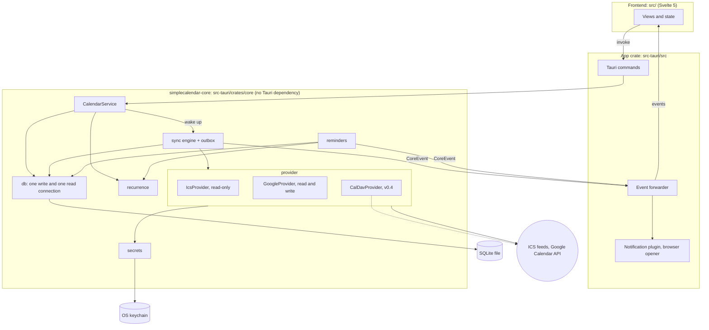
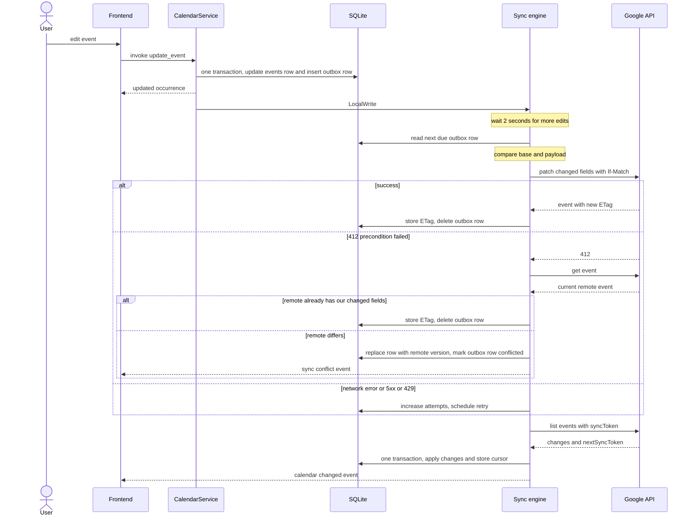

# Architecture

Status: proposed design. Implemented so far: the crate layout (§3), the SQLite connections and
migration 1 (§6), reading a date range with recurrence expansion (§4 Occurrence, §6), the
keychain secret store (§8), the provider traits with the sync engine for read-only sources
(§5, §7.1, §7.2), and the ICS provider (§7.6) with IANA zone names only (§7.7 follows).
Last updated: 2026-10-20 (ICS provider implemented, parser API checked, §7.6, §11, §13).

This document describes how SimpleCalendar stores, syncs and edits calendar data. It is the
reference for the implementation plan. The stack choice itself is recorded in
[ADR 0001](adr/0001-tauri-svelte.md).

## How to read the version markers

Every section starts with a line that says from which version it is needed, and which feature
first needs it. The versions and their order come from the [roadmap](roadmap.md):

| Feature           | Version | Meaning                                                       |
| ----------------- | ------- | ------------------------------------------------------------- |
| ICS subscriptions | v0.1    | Read-only feeds                                               |
| local calendars   | v0.2    | Calendars that live only in SQLite, with create, edit, delete |
| Google read       | v0.2    | Sign-in and syncing Google calendars into SQLite              |
| Google write      | v0.2    | Creating, editing and deleting Google events                  |
| offline sync      | v0.3    | Editing without a connection, retries, conflicts              |
| reminders         | v0.3    | Desktop notifications                                         |
| CalDAV            | v0.4    | CalDAV accounts, read and write                               |
| after v1          | no plan | Features the design keeps open, listed in §1                  |

The week view of v0.1 already needs storage, recurrence and the frontend contract, so those
parts are needed from v0.1 even though local calendars come later.

## 1. Goals and non-goals

_Needed from: v0.1. Applies to every feature._

### In scope for v1

- ICS subscriptions (read-only), Google Calendar (read and write) and, from v0.4, CalDAV (read
  and write), with any number of accounts or subscriptions per provider.
- A local calendar that needs no account, so the app is useful from the first launch.
- Create, edit and delete events. For recurring events: "only this event" and "all events".
- Offline edits through an outbox, incremental sync, server-wins conflict handling.
- Reminders with desktop notifications while the app is running.
- Credentials only in the OS keychain.

### Out of scope for v1

| Not in v1                            | Why, and what the design keeps open                                                                              |
| ------------------------------------ | ---------------------------------------------------------------------------------------------------------------- |
| "This and following events"          | Needs series splitting, the most error-prone calendar operation.                                                 |
| Attendees, invitations, RSVP         | Adds a table and partial-update rules. Guest lists are not stored; only whether you may edit an event is (§4).   |
| Tray icon, background sync           | Sync and reminders only run while the app is open. The scheduler has no window dependency, so this can be added. |
| Asking the user to resolve conflicts | Server wins in v1. The outbox keeps the rejected change, so a UI can come later.                                 |
| Mobile                               | The core crate has no Tauri or desktop dependency, which is the preparation for it.                              |
| AI access (MCP server)               | After v1. Needs no new core logic, only a second front door onto `CalendarService` (§14).                        |

## 2. Overview

_Needed from: v0.1 (ICS subscriptions). The CalDAV provider comes in v0.4._

Three rules from `CLAUDE.md` shape everything below:

1. All calendar logic (parsing, recurrence, sync) lives in Rust.
2. The UI only ever reads the local SQLite database. It never waits for the network.
3. Writes to a remote calendar go through an outbox queue.



How to read it:

- The frontend calls Tauri commands. Commands are thin wrappers that call `CalendarService`
  and convert errors. They contain no logic.
- `CalendarService` is the only entry point into the core. Reads go straight to SQLite (plus
  recurrence expansion). Writes update SQLite, add an outbox row, and wake the sync engine.
- The sync engine is the only component that talks to providers, and the only one that applies
  remote changes to the database.
- Providers do HTTP and translation. They never touch the database.
- The core reports what happened through a channel of `CoreEvent` values. The app crate
  forwards them to the webview and, for due reminders, to the notification plugin.

## 3. Crate layout

_Needed from: v0.1 (ICS subscriptions)._

`src-tauri/` becomes a small Cargo workspace. `cargo` commands keep running from `src-tauri/`
and `Cargo.lock` stays where it is.

```text
src-tauri/
├── Cargo.toml              # [workspace] plus the app crate
├── Cargo.lock
├── src/
│   ├── lib.rs              # builder, managed state, plugins, event forwarder
│   └── commands/           # #[tauri::command] wrappers
└── crates/core/            # package simplecalendar-core
    └── src/
        ├── lib.rs          # CalendarService, CoreEvent
        ├── model/          # Source, Calendar, Event, Occurrence
        ├── db/             # connections, migrations, queries
        ├── provider/       # traits, ics, google
        ├── sync/           # engine, outbox, backoff
        ├── recurrence/     # RRULE expansion, time zone resolution
        ├── reminders/      # scheduler
        └── secrets/        # keychain
```

The package is named **`simplecalendar-core`** and is imported as `simplecalendar_core`. It
must not be named `core`: that is the name of Rust's built-in library that every crate links
(`core::fmt`, `core::option`, and so on), and a package with the same name makes those paths
ambiguous. The directory can stay `crates/core`, since the directory name plays no role in name
resolution. "The core" in this document always means this package.

The rule: `simplecalendar-core` never depends on `tauri`. The compiler enforces it, because
`tauri` is simply not in that package's `Cargo.toml`. Two practical benefits: the recurrence
and sync tests compile without the Tauri and WebKit stack, and the same crate can sit behind a
mobile shell later.

## 4. Data model

_Needed from: v0.1 (ICS subscriptions). Fields that are needed later are marked below._

Three persisted entities and one computed value.

| Type         | Meaning                                                                                   |
| ------------ | ----------------------------------------------------------------------------------------- |
| `Source`     | One account or subscription: a Google account, one ICS URL, or the built-in local source. |
| `Calendar`   | One calendar inside a source. A Google account has several, an ICS URL exactly one.       |
| `Event`      | A single event, the master of a recurring series, or an exception to a series.            |
| `Occurrence` | One concrete appearance of an event on the timeline. Computed per query, never stored.    |

### Source

- The id is a UUID, not an integer, because it is the key of the keychain entry (§8). Integer
  ids start again at 1 when the database is recreated, and a new source would then silently
  pick up a stale token left in the keychain by a previous installation. The one exception is
  the built-in local source: it never has a keychain entry, so it has the fixed id `local`.
  Migration 4 creates it, without calendars, so it exists from the first launch.
- `kind` is `local`, `ics`, `google` or `caldav`.
- `status` is `ok`, `auth_required` or `error`. `auth_required` means the refresh token was
  rejected and the user has to sign in again. The engine stops syncing that source until then.
- A source row holds no secrets. For ICS it stores the host name for display, not the URL.

### Calendar

- `access` is `read` or `write` and comes from the provider (for Google: the access role of the
  account on that calendar).
- **A calendar is writable only if both are true:** its provider implements writing, and
  `access` is `write`. A Google calendar that someone shared with you read-only stays read-only.
- `sync_cursor` is an opaque string owned by the provider (§5).
- `color_override` and `visible` are local preferences and are never synced.

### Event

- **Times.** `start_utc` and `end_utc` are seconds since the Unix epoch, with `end_utc`
  exclusive. `start_tz` says how to interpret them:

  | `start_tz`              | `all_day` | Kind          | Meaning                                                   |
  | ----------------------- | --------- | ------------- | --------------------------------------------------------- |
  | IANA name               | 0         | zoned         | The normal case, for example `Europe/Brussels`            |
  | offset such as `+05:30` | 0         | fixed offset  | Only for ICS events whose zone could not be mapped (§7.7) |
  | `NULL`                  | 0         | floating time | The same wall-clock time wherever the viewer is (§7.7)    |
  | `NULL`                  | 1         | all-day       | A date. "25 December" is the same date everywhere         |

  The zone is needed for recurrence: a weekly meeting at 09:00 in Brussels must stay at 09:00
  local time when daylight saving changes, which moves its UTC time. Floating and all-day
  values store their wall-clock time as if it were UTC, and Rust reinterprets it in the
  viewer's zone when reading.

- **Recurring series.** The master row carries the recurrence lines (`RRULE`, `RDATE`,
  `EXDATE`) exactly as iCalendar and Google express them. Its `start_utc` and `end_utc`
  describe the first occurrence.
- **Exceptions.** An edited occurrence is its own row. It names its series twice:
  `recurring_remote_id` is the master's remote id and is always set; `recurring_event_id` is the
  local row id of the master and is filled in as soon as that row exists (§7.2 explains why
  both are needed). `original_start_utc` names the occurrence it replaces. A deleted occurrence
  is the same kind of row with `status = 'cancelled'`. Google sends exceptions in exactly this
  shape.
- **Identity.** `remote_id` is the provider's id. For events created in this app it is
  generated here, before the event is sent (§7.3).
- **Editability** (needed from v0.2, Google read). An event on a writable calendar can still be
  one you are not allowed to change, typically a meeting someone else organised. Two flags are
  stored from the provider: `is_organizer` (Google: `organizer.self`) and `guests_can_modify`
  (Google: `guestsCanModify`).

  **An event is editable only if** its calendar is writable **and** (`is_organizer` **or**
  `guests_can_modify`).

  A non-editable event is fully read-only in v1: no edit, no delete, no "only this event".
  `CalendarService` enforces this and returns a `NotEditable` error; it does not rely on the UI
  hiding a button. The alternative, sending the edit and letting Google decide, is rejected:
  the result would either be a rollback after the fact or a change that only exists in your own
  copy of the event. Local events are always `is_organizer = 1`. The two flags are never sent
  back to the server.

### Occurrence

`list_occurrences(from, to)` returns occurrences, not events. An occurrence is identified by
`(event_id, original_start)`. For a single event `original_start` equals its start. For a
recurring one it is the start the rule produced, even if an exception moved it. Each occurrence
carries an `editable` flag computed by the rule above.

Occurrences are computed for the requested range only and are never written to the database.
A series without an end date has infinitely many, so storing them is not an option, and
computing a month of them is cheap.

## 5. Provider trait

_Needed from: v0.1. `CalendarProvider` is first needed by ICS subscriptions (v0.1),
`WritableProvider` by Google write (v0.2). The CalDAV implementation comes in v0.4._

### Shape

Reading and writing are two traits. A read-only provider implements only the first, so there is
no write method on it that could be called by mistake.

The code below is the design sketch. The implementation is in `provider/mod.rs` and differs in
these points:

- Remote ids are plain `String`s; `SyncCursor`, `PageToken` and `Etag` are newtypes.
- `RemoteEvent` has the columns of `events`, plus a `SeriesRole` (`Single`, `Master` with its
  recurrence lines, or `Exception` with the master's remote id and the original start). The
  enum rules out the combinations that the table's `CHECK`s forbid.
- `SourceContext` carries the source id and its secret from the keychain. The HTTP client joins
  it with the ICS provider (v0.1), a token source with Google read (v0.2).
- `WritableProvider` declares only `get_event` and `delete_event`. `create_event` and
  `update_event` are added with Google write (v0.2), together with `EventDraft`, `EventUpdate`
  and `FieldSet`, so that those types are designed against a real provider.
- `Providers` maps each `SourceKind` to its provider. A kind without one is never synced.

```rust
/// What the UI may offer for calendars of this provider. Plain data, serialisable.
pub struct Capabilities {
    /// Events can be created, edited and deleted.
    pub writable: bool,
    /// `pull` can return only what changed since a cursor.
    pub incremental_sync: bool,
    /// Reminders round-trip to the server.
    pub reminders: bool,
}

#[async_trait]
pub trait CalendarProvider: Send + Sync {
    fn kind(&self) -> SourceKind;
    fn capabilities(&self) -> Capabilities;

    /// The calendars this source currently exposes.
    async fn list_calendars(&self, cx: &SourceContext)
        -> Result<Vec<RemoteCalendar>, ProviderError>;

    /// One page of changes. `cursor = None` asks for everything.
    async fn pull(
        &self,
        cx: &SourceContext,
        calendar: &CalendarRef,
        cursor: Option<&SyncCursor>,
        page: Option<&PageToken>,
    ) -> Result<ChangeSet, ProviderError>;

    /// `Some` if this provider can write. The default is read-only.
    fn as_writable(&self) -> Option<&dyn WritableProvider> {
        None
    }
}

#[async_trait]
pub trait WritableProvider: CalendarProvider {
    async fn get_event(&self, cx: &SourceContext, calendar: &CalendarRef, id: &RemoteId)
        -> Result<Option<RemoteEvent>, ProviderError>;

    async fn create_event(&self, cx: &SourceContext, calendar: &CalendarRef, draft: &EventDraft)
        -> Result<RemoteEvent, ProviderError>;

    /// `if_match` is the ETag the edit was based on. A mismatch is `ProviderError::Conflict`.
    async fn update_event(
        &self,
        cx: &SourceContext,
        calendar: &CalendarRef,
        update: &EventUpdate,
        if_match: Option<&Etag>,
    ) -> Result<RemoteEvent, ProviderError>;

    async fn delete_event(
        &self,
        cx: &SourceContext,
        calendar: &CalendarRef,
        id: &RemoteId,
        if_match: Option<&Etag>,
    ) -> Result<(), ProviderError>;
}

/// An edit, as the engine hands it to a provider.
pub struct EventUpdate {
    pub id: RemoteId,
    /// The complete state the user wants.
    pub desired: EventDraft,
    /// Which fields differ from the state the server last confirmed.
    pub changed: FieldSet,
}

pub struct ChangeSet {
    pub upserts: Vec<RemoteEvent>,
    pub deletions: Vec<RemoteId>,
    /// true: this pull describes the whole calendar; anything not seen must be deleted locally.
    pub full: bool,
    pub next: Next,
}

pub enum Next {
    /// More pages follow. Nothing is saved as a cursor yet.
    Page(PageToken),
    /// Last page. Store this cursor together with the applied changes.
    Done(SyncCursor),
}

pub enum ProviderError {
    /// Network trouble, HTTP 5xx, rate limit. Retry later.
    Transient { retry_after: Option<Duration> },
    /// Credentials rejected. The user has to sign in again.
    Auth,
    /// The remote copy changed since `if_match`.
    Conflict,
    /// The cursor is no longer valid. Start over with a full pull.
    CursorInvalid,
    NotFound,
    /// Will never succeed (bad request, forbidden). Do not retry.
    Permanent(String),
}
```

Rust notes, since these parts are not obvious:

- A **trait** is Rust's interface. `dyn CalendarProvider` is a "trait object": a value whose
  concrete type is only known at run time. The engine needs that, because it keeps ICS and
  Google providers in one map and calls them the same way.
- **`Send + Sync`** says a provider may be moved to and shared between threads. The async
  runtime (tokio) runs tasks on a pool of threads, so anything a task holds across an `.await`
  must be thread-safe.
- **`#[async_trait]`**: an `async fn` returns a hidden future type that is different for every
  implementation. A trait object needs one fixed signature, so it cannot expose those directly.
  The `async-trait` macro rewrites each method to return a boxed future
  (`Pin<Box<dyn Future + Send>>`). The cost is one small heap allocation per call, which is
  nothing next to an HTTP request. Checked on rustc 1.99: a trait with a native `async fn` is
  still not dyn-compatible (error E0038), so the crate stays (§13 point 2).
- **`WritableProvider: CalendarProvider`** is a supertrait: everything writable is also
  readable. `as_writable` returns `Option<&dyn WritableProvider>`, so the caller has to handle
  the read-only case; the compiler will not let it be forgotten.

`capabilities().writable` must equal `as_writable().is_some()`. A test checks this for every
provider. `Capabilities` exists because the UI needs plain data to decide whether to show an
edit button.

`EventUpdate` carries both the full desired state and the set of changed fields, because
providers need different things. Google sends only the changed fields (§7.5). CalDAV will have
to write a whole iCalendar object and needs the full state. The engine computes `changed` once,
by comparing the outbox row's `base` and `payload`, so that logic is not repeated per provider.

### Rules for providers

- **No database access.** A provider receives what it needs (`SourceContext` carries the HTTP
  client and a way to get a valid access token) and returns plain values. The engine does all
  database work. This keeps providers testable against a mock HTTP server, and the engine
  testable with a fake provider.
- **The cursor is opaque.** The engine stores `SyncCursor` and hands it back, nothing else.
- **No ordering promise.** Events in a change set may come in any order, and an exception may
  arrive pages before its master. The engine deals with that (§7.2), so providers do not sort.
- **Errors are classified by the provider.** The engine only reacts to the six variants above.

### Providers

| Provider | Writable | Needed from                 | Cursor contents                                                                               |
| -------- | -------- | --------------------------- | --------------------------------------------------------------------------------------------- |
| ICS      | no       | v0.1, ICS subscriptions     | JSON with the HTTP `ETag`, `Last-Modified` and a hash of the body                             |
| Google   | yes      | v0.2, Google read and write | `nextSyncToken`                                                                               |
| CalDAV   | yes      | v0.4, CalDAV                | A WebDAV sync-token, or the collection ctag plus the per-event ETags already in `events.etag` |

**Local calendars are not a provider.** A source of kind `local` has no provider at all. The
sync engine skips it, and writes to its calendars do not create outbox rows.

### What CalDAV needs from this design

_Needed from: v0.4 (CalDAV)._

Nothing before v0.4, but the trait was shaped so it fits then without changes:

- `pull` with an opaque cursor covers both CalDAV strategies (sync-token reports, or comparing
  ETags).
- `if_match` on update and delete is how CalDAV does optimistic locking too.
- `EventUpdate.desired` gives it the full state for a whole-object write.
- `events.etag` and `events.ical_uid` exist from the first migration.
- `full = true` covers servers without incremental sync.

## 6. SQLite schema

_Needed from: v0.1 (ICS subscriptions). The table after the DDL says from which version each
table is needed._

One database file in the app-data directory. The schema is created by numbered migrations; the
current migration number is stored in SQLite's built-in `PRAGMA user_version`.

### Two connections

There is one **write connection** and one **read connection**, each behind its own mutex.

| Connection | Used by                                                | Opened                  |
| ---------- | ------------------------------------------------------ | ----------------------- |
| write      | `CalendarService` writes, the sync engine, migrations  | read-write              |
| read       | Everything the UI asks for, and the reminder scheduler | read-only, `query_only` |

The reason is rule 2 of §2: the UI never waits. With a single connection, a
`list_occurrences` call would queue behind whatever the sync engine is writing, and applying a
page of a first sync can take long enough to be noticed. In WAL mode a reader on its own
connection is not blocked by a writer and sees the last committed state. A read never observes
half a transaction.

Details:

- All writes go through the one write connection, so there is never a second writer to wait
  for and `SQLITE_BUSY` cannot occur between our own components.
- A command that writes computes its return value on the write connection, inside or right
  after its transaction, so it cannot return a stale view of its own change.
- `calendar:changed` is emitted after commit, so the re-query it triggers sees the new data.
- The cost is a second page cache. Both connections cap theirs with `PRAGMA cache_size`.
- SQLite calls are blocking, so both connections are used through
  `tokio::task::spawn_blocking`, which moves the call to a thread where blocking is allowed.
- Rust note: a `rusqlite::Connection` may be moved between threads (`Send`) but not used from
  two at once (not `Sync`). Wrapping each in a `Mutex` inside an `Arc` is what makes sharing it
  between tasks legal.

On the write connection:

```sql
PRAGMA journal_mode = WAL;
PRAGMA foreign_keys = ON;
PRAGMA busy_timeout = 5000;
PRAGMA cache_size = -2000;
```

On the read connection:

```sql
PRAGMA query_only = ON;
PRAGMA busy_timeout = 5000;
PRAGMA cache_size = -2000;
```

`foreign_keys` is off by default in SQLite and has to be switched on, otherwise
`ON DELETE CASCADE` does nothing. `cache_size = -2000` means 2000 KiB. `journal_mode` is stored
in the database file, so the read connection inherits it.

### Tables

The DDL shows the state at the end of v1. Tables and columns can be introduced by later
migrations when their feature lands; they do not all have to be in migration 1. Migration 1
(v0.1) leaves out the v0.2 and v0.3 columns from the table below, and also
`events.use_default_reminders`, which belongs to reminders.

```sql
CREATE TABLE sources (
    id              TEXT PRIMARY KEY,           -- UUID; also the keychain key
    kind            TEXT NOT NULL CHECK (kind IN ('local', 'ics', 'google', 'caldav')),
    display_name    TEXT NOT NULL,
    account_label   TEXT,                       -- Google account or ICS host; never a secret
    status          TEXT NOT NULL DEFAULT 'ok'
                    CHECK (status IN ('ok', 'auth_required', 'error')),
    last_error      TEXT,
    sync_interval_s INTEGER,                    -- NULL = provider default
    created_at      INTEGER NOT NULL
) STRICT;

CREATE TABLE calendars (
    id                INTEGER PRIMARY KEY,
    source_id         TEXT NOT NULL REFERENCES sources (id) ON DELETE CASCADE,
    remote_id         TEXT NOT NULL,            -- provider's calendar id; a UUID for local ones
    name              TEXT NOT NULL,
    color             TEXT,                     -- '#rrggbb' from the provider
    color_override    TEXT,                     -- user's choice, never synced
    time_zone         TEXT,                     -- IANA name; default zone for new events
    access            TEXT NOT NULL CHECK (access IN ('read', 'write')),
    visible           INTEGER NOT NULL DEFAULT 1 CHECK (visible IN (0, 1)),
    is_primary        INTEGER NOT NULL DEFAULT 0 CHECK (is_primary IN (0, 1)),
    default_reminders TEXT NOT NULL DEFAULT '[]', -- JSON array of minutes before start
    warnings          TEXT NOT NULL DEFAULT '[]', -- JSON array of messages about the data (§7.7)
    sync_cursor       TEXT,                     -- opaque, owned by the provider
    last_synced_at    INTEGER,
    UNIQUE (source_id, remote_id)
) STRICT;

CREATE TABLE events (
    id                    INTEGER PRIMARY KEY,
    calendar_id           INTEGER NOT NULL REFERENCES calendars (id) ON DELETE CASCADE,
    remote_id             TEXT NOT NULL,        -- provider's id; generated here for new events
    ical_uid              TEXT,
    etag                  TEXT,                 -- NULL until the server has confirmed the row
    status                TEXT NOT NULL DEFAULT 'confirmed'
                          CHECK (status IN ('confirmed', 'tentative', 'cancelled')),
    title                 TEXT NOT NULL DEFAULT '',
    description           TEXT,
    location              TEXT,
    color                 TEXT,
    all_day               INTEGER NOT NULL DEFAULT 0 CHECK (all_day IN (0, 1)),
    start_utc             INTEGER NOT NULL,     -- epoch seconds
    end_utc               INTEGER NOT NULL,     -- epoch seconds, exclusive
    start_tz              TEXT,                 -- IANA name, '+hh:mm', or NULL (floating, all-day)
    end_tz                TEXT,
    recurrence            TEXT,                 -- RRULE/RDATE/EXDATE lines; NULL if not a master
    recurrence_end_utc    INTEGER,              -- end of the last occurrence; NULL = no end
    recurring_remote_id   TEXT,                 -- exceptions: remote id of the master, always set
    recurring_event_id    INTEGER REFERENCES events (id) ON DELETE CASCADE,
                                                -- exceptions: master's row id, once it exists
    original_start_utc    INTEGER,              -- the occurrence an exception replaces
    is_organizer          INTEGER NOT NULL DEFAULT 1 CHECK (is_organizer IN (0, 1)),
    guests_can_modify     INTEGER NOT NULL DEFAULT 0 CHECK (guests_can_modify IN (0, 1)),
    use_default_reminders INTEGER NOT NULL DEFAULT 1 CHECK (use_default_reminders IN (0, 1)),
    pending_delete        INTEGER NOT NULL DEFAULT 0 CHECK (pending_delete IN (0, 1)),
    remote_updated_at     INTEGER,
    UNIQUE (calendar_id, remote_id),
    CHECK (end_utc >= start_utc),
    CHECK ((recurring_remote_id IS NULL) = (original_start_utc IS NULL)),
    CHECK (recurring_event_id IS NULL OR recurring_remote_id IS NOT NULL),
    CHECK (recurrence IS NULL OR recurring_remote_id IS NULL)
) STRICT;

CREATE INDEX events_single ON events (calendar_id, start_utc, end_utc)
    WHERE recurrence IS NULL;
CREATE INDEX events_masters ON events (calendar_id)
    WHERE recurrence IS NOT NULL;
CREATE INDEX events_exceptions ON events (recurring_event_id)
    WHERE recurring_event_id IS NOT NULL;
CREATE INDEX events_unlinked ON events (calendar_id, recurring_remote_id)
    WHERE recurring_remote_id IS NOT NULL AND recurring_event_id IS NULL;

CREATE TABLE event_reminders (
    event_id       INTEGER NOT NULL REFERENCES events (id) ON DELETE CASCADE,
    method         TEXT NOT NULL DEFAULT 'popup' CHECK (method IN ('popup', 'email')),
    minutes_before INTEGER NOT NULL CHECK (minutes_before BETWEEN 0 AND 40320),
    PRIMARY KEY (event_id, method, minutes_before)
) STRICT, WITHOUT ROWID;

CREATE TABLE fired_reminders (
    event_id         INTEGER NOT NULL REFERENCES events (id) ON DELETE CASCADE,
    occurrence_start INTEGER NOT NULL,
    minutes_before   INTEGER NOT NULL,
    fired_at         INTEGER NOT NULL,
    PRIMARY KEY (event_id, occurrence_start, minutes_before)
) STRICT, WITHOUT ROWID;

CREATE TABLE outbox (
    id              INTEGER PRIMARY KEY AUTOINCREMENT, -- processing order
    calendar_id     INTEGER NOT NULL REFERENCES calendars (id) ON DELETE CASCADE,
    event_id        INTEGER REFERENCES events (id) ON DELETE SET NULL,
    event_remote_id TEXT NOT NULL,
    op              TEXT NOT NULL CHECK (op IN ('create', 'update', 'delete')),
    payload         TEXT,                       -- JSON: the state the user wants; NULL for delete
    base            TEXT,                       -- JSON: the row as the server last confirmed it
    base_etag       TEXT,                       -- sent as If-Match
    status          TEXT NOT NULL DEFAULT 'pending'
                    CHECK (status IN ('pending', 'in_flight', 'conflicted', 'failed')),
    attempts        INTEGER NOT NULL DEFAULT 0,
    next_attempt_at INTEGER NOT NULL DEFAULT 0,
    last_error      TEXT,
    created_at      INTEGER NOT NULL
) STRICT;

CREATE INDEX outbox_due ON outbox (status, next_attempt_at);
CREATE INDEX outbox_event ON outbox (event_id);

CREATE TABLE settings (
    key   TEXT PRIMARY KEY,
    value TEXT NOT NULL
) STRICT, WITHOUT ROWID;
```

| Table or column                                                                  | Needed from                          |
| -------------------------------------------------------------------------------- | ------------------------------------ |
| `sources`, `calendars`, `events`, `settings`                                     | v0.1, ICS subscriptions              |
| `calendars.sync_cursor`, `events.ical_uid`, index `events_unlinked`              | v0.1, ICS subscriptions              |
| `events.etag`, `events.is_organizer`, `events.guests_can_modify`                 | v0.2, Google read                    |
| `event_reminders`, `events.use_default_reminders`, `calendars.default_reminders` | v0.2, Google read (migration 3, #14) |
| the `local` row in `sources`                                                     | v0.2, local calendars (migration 4)  |
| `outbox`, `events.pending_delete`                                                | v0.2, Google write                   |
| `fired_reminders`                                                                | v0.3, reminders                      |

Notes:

- `STRICT` makes SQLite reject a value of the wrong type instead of storing it anyway.
- Rows are always updated with `INSERT ... ON CONFLICT DO UPDATE`, never `INSERT OR REPLACE`.
  The latter deletes and re-creates the row: it would get a new `id`, and the cascade would
  delete the exceptions of a series every time its master is synced.
- `event_reminders.method` keeps Google's `email` reminders intact when an event is saved back.
  Only `popup` reminders produce a notification.
- `settings` holds non-secret preferences (week start, sync intervals, an optional OAuth client
  id override). Secrets never go here.
- There is no table for occurrences, by design (§4).

### Reading a date range

Two queries on the read connection, then expansion in Rust. Both ranges are widened by 14 hours
on each side before querying, because all-day and floating events are stored as if in UTC and
can fall on the neighbouring day in the viewer's zone. Rust filters the result precisely.

```sql
-- Single events and linked exceptions that overlap the range.
SELECT e.*
FROM events e
JOIN calendars c ON c.id = e.calendar_id
WHERE c.visible = 1
  AND e.recurrence IS NULL
  AND e.pending_delete = 0
  AND e.status <> 'cancelled'
  AND (e.recurring_remote_id IS NULL OR e.recurring_event_id IS NOT NULL)
  AND e.start_utc < :to
  AND e.end_utc > :from;

-- Series that can still produce an occurrence in the range.
SELECT e.*
FROM events e
JOIN calendars c ON c.id = e.calendar_id
WHERE c.visible = 1
  AND e.recurrence IS NOT NULL
  AND e.pending_delete = 0
  AND e.status <> 'cancelled'
  AND e.start_utc < :to
  AND (e.recurrence_end_utc IS NULL OR e.recurrence_end_utc > :from);
```

For each series the `recurrence` module expands the rule inside the range, in the event's own
zone. All exceptions of that series, cancelled ones included, are loaded through
`events_exceptions`; each one removes the occurrence it replaces. Exceptions that are not
cancelled appear through the first query, at their own (possibly moved) time. An exception that
is not linked to a master yet is invisible to both queries (§7.2). A cancelled master means the
whole series was deleted, so the second query skips it as well.

How `recurrence::expand` treats the recurrence lines:

- `rrule` generates only the `RRULE` dates. A zoned series is expanded in its own zone. Floating
  and all-day series are expanded on the wall clock stored as UTC. A fixed-offset series is
  shifted to its wall clock and back, because `rrule` has no fixed offsets.
- `RDATE`, `EXDATE` and `UNTIL` are parsed in the core. Each value is turned into a stored value
  on its own, so exclusions match by instant (§7.7 "Mixed forms"). `rrule` would read a value
  without `Z` or `TZID` in the machine's zone, which is wrong on every machine but one. A
  date-form `UNTIL` includes that whole day.
- Local times follow RFC 5545 §3.3.5. A time inside a spring-forward gap is read with the offset
  from before the gap (02:30 becomes 03:30). A time that exists twice is the earlier one.
- If a series cannot be expanded, the problem is logged and only its first occurrence is shown.
  The rest of the range is unaffected.
- The function is `simplecalendar_core::db::occurrences::list_occurrences`. The
  `pending_delete` conditions are left out until that column arrives in v0.2.

## 7. Sync engine

_Needed from: v0.1 (ICS subscriptions). Subsections that are needed later are marked._

### 7.1 Structure

_Needed from: v0.1 (ICS subscriptions). The focus and local-write triggers come in v0.3 (offline
sync)._

One long-lived task owns a queue of commands (`SyncNow(source)`, `LocalWrite(source)`,
`Shutdown`). At most one sync cycle runs per source at a time. A request that arrives during a
cycle sets a "run again" flag instead of starting a second one. Different sources sync in
parallel.

Triggers:

| Trigger            | Behaviour                                                  |
| ------------------ | ---------------------------------------------------------- |
| App start          | Every source once                                          |
| Timer              | Google every 15 minutes, ICS every 60, per-source override |
| Window gains focus | Every source, at most once per minute                      |
| Local write        | That source, 2 seconds after the last write                |
| Manual refresh     | Immediately                                                |

Implementation notes (`sync/`):

- `SyncEngine::new` returns the engine and a `SyncHandle`. The shell spawns `engine.run()` on
  its runtime, so the core does not depend on which runtime that is. The handle has
  `sync_all` (app start), `sync_now(source?)` (manual) and `shutdown`.
- The engine task keeps its bookkeeping without locks: which sources are running, which were
  requested again, and when each is due. Cycles run as separate tasks and report back with a
  message. Several requests during one cycle produce exactly one more cycle.
- The timer counts from the end of a cycle. The interval is `sources.sync_interval_s` if set,
  else the default of the kind. Waiting uses `timeout_at` on the queue, not a second task.
- A source with status `auth_required` is skipped by app start and the timer. A manual sync
  still tries it, so an ICS feed that rejected a request once can recover without a sign-in.
- Without a keychain the cycle fails before any request, with the message from §8 as
  `last_error`.

### 7.2 One cycle for one source

_Needed from: v0.1 (ICS subscriptions). Step 2 is needed from v0.2 (Google write)._

1. **Authenticate.** Get an access token, refreshing it if needed.
2. **Push.** Send due outbox rows in order (§7.3).
3. **List calendars.** Add new ones, update names, colours and access, remove those that are
   gone.
4. **Pull.** For each calendar, page through `pull`. Each page is applied in its own
   transaction. On the last page, the changes **and the new cursor are committed in the same
   transaction**. A crash can therefore never leave a cursor that claims more than what was
   applied.
5. **Notify.** Emit `calendar:changed` with the affected calendar ids.

Push comes before pull so that the pull already sees the result of our own writes.

#### Applying a page

- `calendar:changed` is sent after every committed page that changed something, and after the
  calendar list step if a calendar was added, changed or removed. A first sync therefore shows
  up page by page. A pull that changed nothing sends nothing.
- `events.recurrence_end_utc` is not filled in yet and stays `NULL`, which the read query
  treats as "no end": correct, only less selective. Computing it from `UNTIL` and `COUNT` is
  recurrence logic and belongs in `recurrence`.
- For a full pull (`full = true`) the engine remembers every remote id it saw. After the last
  page it deletes local events that were not seen, except those that still have a pending
  `create` in the outbox.
- An upsert for an event that has a pending outbox row is a conflict (§7.4).
- Exceptions and masters are linked as described next.

#### Exceptions that arrive before their master

A provider gives no ordering promise. In a paged Google sync an exception can be on page 1 and
its master on page 3, each page being its own transaction. An ICS file may list a
`RECURRENCE-ID` component before the event it belongs to. A foreign key to the master's row id
alone cannot express "the master is not here yet".

**Chosen: store the master's remote id on the exception and link when both exist.**

- Every exception stores `recurring_remote_id`. That value is known the moment the exception
  arrives, whatever the order.
- `recurring_event_id` (the row id, with the foreign key and cascade) is filled in by two
  statements, both inside the transaction of the page being applied:

```sql
-- After upserting an exception: link it if its master is already here.
UPDATE events
SET recurring_event_id = (
    SELECT m.id
    FROM events m
    WHERE m.calendar_id = events.calendar_id
      AND m.remote_id = events.recurring_remote_id
)
WHERE id = :exception_id;

-- After upserting a master: adopt the exceptions that arrived before it.
UPDATE events
SET recurring_event_id = :master_id
WHERE calendar_id = :calendar_id
  AND recurring_remote_id = :master_remote_id
  AND recurring_event_id IS NULL;

-- After the last page of a full pull: remove exceptions whose series never arrived.
DELETE FROM events
WHERE calendar_id = :calendar_id
  AND recurring_remote_id IS NOT NULL
  AND recurring_event_id IS NULL;
```

- The result is an invariant that holds at every commit: **an exception is linked if and only
  if its master exists locally.**
- An unlinked exception is invisible to every read query. So the UI can be missing an edited
  occurrence for the duration of a first sync, but it never shows an occurrence twice (once
  from the rule, once from the exception), and never shows an exception as a stray single
  event.
- After an incremental pull, unlinked exceptions are left alone and logged. They can only come
  from inconsistent server data, and the next full pull removes them.

**Rejected: a staging table.** All pages would be written to a staging table first and applied
in one transaction at the end, masters first.

|                              | Remote id + link (chosen)                                                   | Staging table                                      |
| ---------------------------- | --------------------------------------------------------------------------- | -------------------------------------------------- |
| Extra schema                 | One column, one partial index                                               | A table that mirrors `events` or holds JSON        |
| Writes per synced event      | One                                                                         | Two (stage, then apply)                            |
| First sync of a big calendar | Events appear page by page                                                  | Nothing appears until the last page is in          |
| Largest transaction          | One page                                                                    | The whole calendar, with the write connection held |
| Incremental pulls            | Same code path                                                              | Still needs ordering logic, or stages those too    |
| Other uses                   | Providers need the master's remote id anyway to address a single occurrence | None                                               |

The staging table's one advantage is that a first sync becomes visible all at once. That is not
worth doubling the writes and holding one long transaction, and the invisibility rule above
already prevents wrong intermediate states.

### 7.3 Outbox

_Needed from: v0.2 (Google write): the one-transaction write, order, sending only the
difference, deletes and safe retries for creates. Backoff, coalescing and crash recovery come in
v0.3 (offline sync)._

A local edit to a remote calendar is one SQLite transaction that

1. changes the `events` row, so the UI shows the edit immediately, and
2. inserts an outbox row with the desired state (`payload`), the state before the edit (`base`)
   and the ETag the edit was based on (`base_etag`).

Either both happen or neither.

Rules:

- **Order.** Rows are processed by `id`. Rows for the same event never overtake each other.
- **Only the difference is sent.** When a row is pushed, the engine compares `base` and
  `payload` field by field and hands the provider the set of changed fields (§5). If nothing
  differs, for example after an edit that was undone, the row is deleted without a request.
- **Coalescing.** A second edit to an event that still has a pending row updates that row's
  payload and keeps the original `base`, so the difference is always against what the server
  has. An update to an event with a pending `create` merges into the create. A delete of an
  event with a pending `create` removes both: the server never hears about it.
- **Deletes.** The row stays in `events` with `pending_delete = 1` and is hidden from queries.
  It is removed once the server confirms.
- **Safe retries for creates.** The event id is generated here (a UUID in hexadecimal, which
  fits Google's rule of 5 to 1024 characters from `a`-`v` and `0`-`9`) and sent with the insert.
  If the response is lost and the insert is retried, Google reports that the id exists. That is
  treated as success, and the event is fetched to get its ETag. Without this, a lost response
  would create a duplicate.
- **Crash recovery.** At startup, rows left `in_flight` go back to `pending`.

Outcome per attempt:

| Result               | Action                                                                                                           |
| -------------------- | ---------------------------------------------------------------------------------------------------------------- |
| Success              | Store the new ETag on the event, delete the outbox row                                                           |
| `Transient`          | `attempts + 1`, set `next_attempt_at` with exponential backoff and jitter (cap 30 minutes), honour `Retry-After` |
| `Auth`               | Refresh the token once and retry. If that fails: source becomes `auth_required`, rows stay `pending`             |
| `Conflict`           | See §7.4                                                                                                         |
| `NotFound` on update | The event was deleted remotely. Treated as a conflict: remove locally, row becomes `conflicted`                  |
| `NotFound` on delete | Already gone. Success                                                                                            |
| `Permanent`          | Roll the event back to `base` (or remove it, for a create). Row becomes `failed`                                 |

`conflicted` and `failed` rows are kept so the UI can list them ("your change to X could not be
saved") and the user can dismiss or redo them. They no longer block later edits to the event.

### 7.4 Conflicts: server wins

_Needed from: v0.3 (offline sync). Until then the ETag check alone already holds: v0.2 never
overwrites a newer server version._

A conflict is one of:

- the server answers an update or delete with HTTP 412, because the ETag no longer matches, or
- a pull delivers a change for an event that still has a pending outbox row.

Handling:

1. On 412 the engine fetches the event once. If the remote copy already has our value in every
   changed field, our earlier attempt succeeded and only its response was lost: store the ETag,
   delete the row, no notice. This avoids false conflict reports after a dropped connection.
2. Otherwise the remote version replaces the local row, the outbox row becomes `conflicted`
   with its `payload` intact, and `sync:conflict` is emitted.

Nothing is ever overwritten on the server without an ETag check, so an edit made on a phone or
by someone else is never silently lost.



### 7.5 Google specifics

_Needed from: v0.2 (Google read and Google write)._

Checked against Google's Calendar API documentation on 2026-10-13.

Reading:

- **First sync:** `events.list` without a token, following `nextPageToken` until the last page,
  which carries `nextSyncToken`. The provider returns `full = true`.
- **Incremental sync:** the same request with `syncToken`. The request parameters must be the
  same as in the first sync, and most filters cannot be combined with a sync token.
- **Recurring events** are requested unexpanded (`singleEvents=false`), so the response
  contains masters and exceptions, which is what the schema stores. Their order is not
  guaranteed (§7.2).
- **Deletions** arrive as events with `status = cancelled`. A cancelled entry that has a
  `recurringEventId` is a cancelled occurrence and is stored as an exception. A cancelled entry
  without one is a real deletion.
- **HTTP 410** means the sync token expired. The provider returns `CursorInvalid`, the engine
  clears the cursor and runs a full pull.
- **Zones.** Google uses IANA names. An event without `start.timeZone` takes the zone of its
  calendar.
- **Editability.** `organizer.self` and `guestsCanModify` are stored as `is_organizer` and
  `guests_can_modify` (§4). Both default to false when absent, as documented.
- **Reminders** map to `reminders.useDefault` and `reminders.overrides` (at most 5, each 0 to
  40320 minutes). Calendar defaults are stored in `calendars.default_reminders`.

Implementation notes (#14):

- `provider/google/`: `json.rs` turns Google's resources into the provider's types, `mod.rs`
  does the HTTP. Pages are 250 entries. Every request carries `singleEvents=false` and
  `maxResults=250`; the first sync adds nothing else, later ones add `syncToken`, and a page
  adds `pageToken`.
- A 401 drops the access token and tries once more with a refreshed one; a second 401 is
  `Auth`. 410 is `CursorInvalid`, 404 `NotFound`, 429, 5xx and a 403 with reason
  `rateLimitExceeded`, `userRateLimitExceeded` or `quotaExceeded` are `Transient` (with
  `Retry-After` when sent), anything else `Permanent` with Google's message.
- The calendar list: the name is `summaryOverride`, else `summary`. Calendars with only
  free/busy access are left out. `primary` sets `is_primary`; `defaultReminders` keeps the
  popup ones. Calendar ids are percent-encoded in the path (`#` becomes `%23`).
- Until Google write (#18) the provider does not write, so `owner` and `writer` calendars are
  stored as `read` (§4: writable needs both). #18 flips `WRITES`.
- Event colours: `colorId` 1 to 11 map to the colours Google Calendar shows today (Lavender
  `#7986cb` to Tomato `#d50000`), not the paler palette of the API's `colors` resource.
- A cancelled occurrence without its own `start` and `end` takes its `originalStartTime` for
  both. An event that cannot be read is skipped with a warning on its calendar.
- Reminders: `useDefault` and `overrides` (`popup` and `email`) go to
  `events.use_default_reminders` and `event_reminders`, replaced as a whole on every update.
- The sidebar shows one group per Google account, named after it (`groupCalendars`).
- Descriptions are stored as Google sends them. Notes formatted in Google's web interface are
  HTML (`<br>`, `<b>`, links); the rest is plain text. `get_event` (#16) must turn them into
  plain text in Rust and the popover must never render them as HTML: a shared calendar could
  otherwise inject markup. Since #16 it does (`service/text.rs`): line-breaking tags become
  newlines, list items bullets, links "text (address)", other tags are dropped. Descriptions
  of other sources are returned as they are, so a local note may contain `<b>` as text.

Writing:

- **Edits use `events.patch`, never `events.update`.** The request body contains only the
  fields in `EventUpdate.changed`. An update replaces the whole event, and this app stores only
  part of one: guests, conferencing details, attachments and extended properties would be
  erased by every edit. A patch leaves everything it does not mention untouched.
- **Arrays are replaced as a whole** by a patch. `recurrence` and `reminders.overrides` are
  arrays this app owns completely, so they are sent in full when they changed. `attendees` is
  an array this app does not store and is therefore never sent.
- **Cost.** A patch counts as three quota units. Google's reference suggests a get followed by
  an update to save quota. That is not done here: it is two requests per edit, and the update
  would still have to carry back every field the app does not model. Edits by one person are
  far too infrequent for the difference to matter.
- **`sendUpdates` is set on every insert, patch and delete.** It is passed explicitly because
  the reference does not state a default for it. The value in v1 is `none`. The app has no
  guest list and cannot ask "notify the guests?", so it does not send email in the user's name.
  Consequence: guests who use Google Calendar see the change in their calendar, guests on other
  systems are not told. This is revisited together with attendee support (§13).
- **Preconditions.** Patches and deletes send `If-Match` with the stored ETag; a mismatch is
  HTTP 412.
- **"Only this event"** edits address the single occurrence on Google's side, using the
  master's remote id and the original start. How that occurrence is looked up is internal to
  `GoogleProvider`.
- **Never sent:** `organizer`, `guestsCanModify`, and anything else the app only reads.

### 7.6 ICS specifics

_Needed from: v0.1 (ICS subscriptions)._

- `webcal://` URLs are rewritten to `https://`.
- The request sends `If-None-Match` and `If-Modified-Since` from the cursor. HTTP 304 means
  nothing changed.
- Otherwise the body is hashed. If the hash equals the one in the cursor, nothing changed
  either (many servers do not support conditional requests).
- If it did change, the feed is parsed and returned as one `full = true` change set.
- `remote_id` is the event's `UID`, combined with `RECURRENCE-ID` for exceptions. The master's
  remote id of an exception is the plain `UID`.
- Components may appear in any order in the file (§7.2).
- Alarms inside a feed (`VALARM`) are ignored in v1.

Implementation notes (`provider/ics/`):

- A feed is one calendar with remote id `feed`, read-only, named after the source. Listing it
  fetches nothing.
- The hash leaves out `DTSTAMP` lines. Google sets `DTSTAMP` to the time of the request on
  every event, so its feeds were never byte-identical twice and every fetch was a full
  re-apply. The app stores nothing from `DTSTAMP`.
- A changed body is parsed on a blocking thread. One that is not iCalendar is a `Permanent`
  error with a fixed message: the parser's own error quotes the feed, which would put calendar
  contents into `last_error`. Bodies over 32 MiB are refused.
- HTTP 401 and 403 are `Auth` (a private feed whose token was revoked), 408, 429 and 5xx are
  `Transient` with `Retry-After` in seconds, other statuses and a missing URL are `Permanent`.
  Network failures are `Transient`. No message contains the URL, which is a secret (§8).
- An exception's remote id is `UID#<original start as stored>`.
- An event without a `UID` or a readable `DTSTART` is logged and skipped. Without `DTEND` or
  `DURATION`, a date lasts one day and a date-time has no length. Days and weeks in a
  `DURATION` move the wall clock (RFC 5545 §3.3.6).
- `TZID`s in `RDATE` and `EXDATE` lines are resolved like `DTSTART` (§7.7) and written as the
  IANA name they resolve to, so the `recurrence` module reads them the same way. Local values
  without `TZID` get the feed's `X-WR-TIMEZONE` written on. A zone that only resolves to fixed
  offsets has no name, so its values are written in UTC.

### 7.7 ICS time zones

_Needed from: v0.1 (ICS subscriptions)._

Google always gives an IANA zone. ICS feeds do not. A `TZID` can be an IANA name, a Windows
zone name (Outlook and Exchange), a display string, or a made-up label that only means
something together with a `VTIMEZONE` block in the same file. A time can also have no zone at
all.

#### Resolving a `TZID`

The first rule that matches wins.

| Step | The `TZID` is...                                                                                      | Result                                                                                   |
| ---- | ----------------------------------------------------------------------------------------------------- | ---------------------------------------------------------------------------------------- |
| 1    | an IANA name, for example `Europe/Brussels` (quotes and spaces trimmed)                               | that zone                                                                                |
| 2    | a longer id that ends in an IANA name, for example `/freeassociation.sourceforge.net/Europe/Brussels` | that zone (the longest suffix after a `/` that is a valid name)                          |
| 3    | a Windows zone name, for example `Romance Standard Time`                                              | the IANA zone from the Windows mapping table                                             |
| 4    | defined by a `VTIMEZONE` in the feed                                                                  | see "Feed-defined zones" below                                                           |
| 5    | none of the above                                                                                     | the feed's `X-WR-TIMEZONE` if it resolves, otherwise floating; the source gets a warning |

A name wins over a `VTIMEZONE` with the same id (steps 1 to 3 come before step 4). The
definitions that exporters embed are often cut down to a single year or out of date, while the
name states what the author meant.

#### Windows zone names

Outlook and Exchange write `TZID=W. Europe Standard Time` rather than `Europe/Berlin`. These are
mapped with the `windowsZones` table from the Unicode CLDR project, using the default territory
(`001`) row for each Windows zone.

The table is about 140 rows. It is generated from the CLDR file by a script and checked into
the repository with the CLDR version noted, rather than taken from a crate: it is static data,
and owning it avoids a dependency for something this small. Lookup is case-insensitive.

Display strings such as `(UTC+01:00) Brussels, Copenhagen, Madrid, Paris` are not Windows zone
ids and are not in that table. Feeds that use them include a `VTIMEZONE`, so they fall through
to step 4.

#### Feed-defined zones

A `VTIMEZONE` describes a zone as a list of `STANDARD` and `DAYLIGHT` rules, each with an
offset and a rule for when it starts. Such a zone cannot be stored as an IANA name directly, so
it is handled in this order:

1. **Hint.** If the block has an `X-LIC-LOCATION` property with a valid IANA name, use it.
2. **Match by behaviour.** Compute the offset the `VTIMEZONE` gives on the first day of every
   month, from the event's start until three years later. Find the IANA zones that give the
   same offsets on all those days. If the feed's `X-WR-TIMEZONE` is among them, use it;
   otherwise use the first in alphabetical order. Any of them behaves identically over the
   compared period, so the choice does not change what is displayed.
3. **Fixed offset.** If no IANA zone matches, the offset the `VTIMEZONE` gives for that
   date-time is used to compute the correct UTC instant, and `start_tz` stores that offset
   (`+05:30`). A recurring event then repeats at a fixed offset, which is wrong across a
   daylight-saving change in such a zone. The source gets a warning. Real zones always match in
   step 2, so this is the path for broken data.

This needs a small evaluator for `VTIMEZONE` rules (which offset applies at a given local
time). It lives in the `recurrence` module next to the expansion code.

#### Floating times

A time with no `TZID` and no `Z` is "floating" in iCalendar: 09:00 means 09:00 wherever the
viewer is.

- **If the feed declares `X-WR-TIMEZONE`,** a time without a zone is read in that zone and
  stored as a normal zoned event. This is a deliberate deviation from the standard. It follows
  the common convention: feeds that set this property and leave out `TZID` mean "all times are
  in this zone", and genuinely floating events are rare in subscription feeds.
- **Otherwise it is stored as floating:** `start_tz` is `NULL`, `all_day` is 0, and the
  timestamps hold the wall-clock time as if it were UTC. On read, Rust interprets it in the
  viewer's zone, so it shows at the same clock time for everyone. Recurrence is expanded on the
  wall clock, with no daylight-saving adjustment.

#### Mixed forms inside one event

The parts of one event do not have to use the same form: a start with a `TZID`, exclusion dates
in UTC, a `RECURRENCE-ID` that is floating. Every value is resolved on its own with the rules
above, and occurrences, exclusions and exceptions are matched by instant, never by comparing
the text.

The test cases for all of this are listed in §12.

#### Implementation notes

- The resolver is `provider/ics/parse/zones.rs`, one per `VCALENDAR`. It remembers the answer
  for each `TZID`, so a feed with thousands of events resolves each name once.
- The evaluator is `recurrence/vtimezone/`. It turns the observances into a sorted list of
  onsets up to the year 2200, starting from each `DTSTART` (Outlook writes 1601). A rule's
  `UNTIL` is UTC and is moved to the wall clock with `TZOFFSETFROM` before expanding.
- Behavioural matching compares at noon UTC on the first of each month, away from the night-time
  hours when zones change. The window starts on 1 January of the value's year, not at the
  event's start, so all values of one year share one match. The candidates are every zone
  `chrono-tz` knows, aliases included, so the alphabetical pick can be a name such as
  `Africa/Ceuta` for European rules. It behaves the same as `Europe/Brussels` over the window.
- A Windows name that is also an IANA name (`UTC`) resolves in step 1.
- The Windows table is `provider/ics/windows_zones.rs`, generated by
  `scripts/windows-zones.mjs` from CLDR `release-48-2`. Run the script with a newer tag to
  update it.
- **Warnings** are stored per calendar in `calendars.warnings`, a JSON array, so a source with
  several calendars keeps each one's warnings apart. A source's warnings are those of its
  calendars. Each message is listed once, however many events it affects. A full pull replaces
  the calendar's warnings, an incremental pull adds to them, and a pull that fails or finds the
  feed unchanged leaves them as they were. `ChangeSet.warnings` carries them from the provider
  to the engine.

## 8. Credentials

_Needed from: v0.1 (ICS subscriptions; the feed URL is the first secret). The Google sign-in
part is needed from v0.2 (Google read), the CalDAV password from v0.4._

### What is stored where

| Item                               | Location                                      |
| ---------------------------------- | --------------------------------------------- |
| Google refresh token               | OS keychain                                   |
| Google access token                | Memory only. Short-lived, re-created at start |
| Full ICS URL                       | OS keychain                                   |
| OAuth client secret override       | OS keychain                                   |
| CalDAV password                    | OS keychain                                   |
| Account label, ICS host, client id | SQLite (not secret)                           |

ICS URLs are treated as secrets because private feed addresses, including Google's own "secret
address in iCal format", contain a token that grants access to the calendar.

Keychain entries use the bundle identifier as the service name
(`com.adriaancloet.simplecalendar`) and `source:<uuid>` as the account. The value is a small
JSON document with a version field. Only the refresh token is stored, not the whole token
response: Windows limits a credential to 2560 bytes.

### Platforms

| Platform | Backend                                                           |
| -------- | ----------------------------------------------------------------- |
| Ubuntu   | Secret Service over D-Bus, provided by GNOME Keyring (or KWallet) |
| Windows  | Credential Manager                                                |

### `SecretStore`

The core defines a small trait with `probe`, `get`, `set` and `delete`. There are two
implementations: one on top of the keychain, and an in-memory one for tests. Keychain calls can
block (on Linux they may show an unlock prompt), so they also run through `spawn_blocking`.

### When no keyring is available

This happens on Linux with a minimal window manager, in a session without GNOME Keyring, or
when the keyring is locked and the prompt is dismissed.

- At startup the store is probed with a harmless read.
- If the probe fails, the app **keeps working for local calendars**. Remote sources are not
  synced, and adding one is blocked.
- There is **no fallback to a file or to SQLite**, in any circumstance.
- The error distinguishes two cases and tells the user what to do:

| Case       | Message                                                                                                                                                                                                                                                      |
| ---------- | ------------------------------------------------------------------------------------------------------------------------------------------------------------------------------------------------------------------------------------------------------------ |
| No service | "SimpleCalendar could not find a system keyring. Account credentials are stored in the system keyring (GNOME Keyring or KWallet), never in files. Install and start `gnome-keyring`, log in again and restart SimpleCalendar. Local calendars keep working." |
| Locked     | "The system keyring is locked. Unlock it and try again."                                                                                                                                                                                                     |

The frontend gets this as a structured error (`secrets_unavailable` with a reason), not as a
string to parse, and can re-run the probe from a "Try again" button.

`keyring-core` reports a locked or denied store as `NoStorageAccess`, which becomes `locked`.
The D-Bus store returns `PlatformFailure` when it cannot connect, which becomes `no_service`.
Both Linux cases were checked in a real session:

| Session                      | Error from connecting                                                |
| ---------------------------- | -------------------------------------------------------------------- |
| D-Bus, but no Secret Service | `PlatformFailure(Dbus(org.freedesktop.DBus.Error.ServiceUnknown))`   |
| No D-Bus session at all      | `PlatformFailure(Dbus(org.freedesktop.DBus.Error.Spawn.ExecFailed))` |

`scripts/test-keychain.sh` re-runs this check, plus a round trip against a fresh GNOME Keyring,
in throwaway D-Bus sessions that never touch the user's own keyring.

Implementation notes:

- The probe reads the `probe` account, which never holds a value. On Linux a locked keyring is
  only noticed at the first write, when the unlock prompt appears; if it is dismissed, that
  write fails with `locked`.
- The connection to the Secret Service is made on first use. After a failure it is dropped and
  made again on the next call. Starting a keyring and pressing "Try again" therefore works
  without a restart.
- `get_status` re-probes while the last result was a failure. It reports
  `secrets_unavailable` or `null`.
- `Secrets::require` is the check that adding a remote source runs first.
- The stored value is `{"v": 1, "kind": "ics_url", "url": ...}`. A value with an unknown version
  is refused, not guessed at. `Debug` output of a secret is redacted.

### Google sign-in

_Needed from: v0.2 (Google read)._

- OAuth 2.0 authorization code flow with PKCE, for an "installed application".
- The app listens on `127.0.0.1` on a free port, opens the system browser at Google's consent
  page with that address as redirect URI, receives the code, and exchanges it for tokens. The
  `state` parameter is checked. The listener closes after one request or after 5 minutes.
- **Client id and secret** are read at compile time from environment variables
  (`option_env!`, which yields `None` if the variable is not set) and are never committed. The
  local build takes them from an untracked `.env`, CI from a repository secret. If none were
  compiled in, Google sign-in asks for a client id in settings.
- A runtime override in settings takes precedence, so anyone building from source can use their
  own Google Cloud project.
- Google treats the client secret of an installed application as not confidential, since it can
  be extracted from any binary. Keeping it out of git is still correct: it avoids the repository
  being flagged and makes rotating it a CI change.
- Google's OAuth documentation says that projects whose consent screen is in "Testing" status
  get refresh tokens that expire after 7 days. That shows up here as `auth_required` once a week
  (§13 point 8).

Implementation notes (#13):

- `simplecalendar_core::google`: `oauth.rs` (scopes, PKCE, authorization URL, code exchange,
  refresh), `loopback.rs` (the listener) and `auth.rs` (`GoogleAuth`: which client to use, and
  the access tokens in memory). The authorization URL asks for `access_type=offline` and
  `prompt=consent`, so every sign-in returns a refresh token, also for an account that agreed
  before. Signing in again passes the account as `login_hint`.
- The listener answers the first `GET` that arrives, whatever its `state`, and closes; a
  connection that sends nothing (a browser's preconnect) does not hold it up. A wrong `state` is
  refused. It also stops when the user cancels.
- The compiled-in client comes from `SIMPLECALENDAR_GOOGLE_CLIENT_ID` and
  `SIMPLECALENDAR_GOOGLE_CLIENT_SECRET`: from the environment, else from the untracked `.env`
  at the repository root, which `src-tauri/build.rs` reads (`.env.example` lists them). The
  user's own client id is the setting `google.client_id`; its secret is the keychain account
  `app:google-client-secret`.
- A Google source's keychain value is `{"v": 1, "kind": "google_refresh_token", ...}`. Its
  `display_name` and `account_label` are the account's address. Signing in to an account that is
  already there reuses its source and sets it back to `ok`; signing in again from a source
  refuses another account.
- A refresh that Google answers with `invalid_grant` is `ProviderError::Auth`, which the engine
  stores as `auth_required` (§7.2). The Google provider (#14) gets its tokens from
  `GoogleAuth::access_token`.
- Removing a Google source deletes its refresh token but does not revoke it at Google.

## 9. Reminders

_Needed from: v0.3 (reminders). Confirmed in review: reminders are part of v1._

- A scheduler task in the core looks at the occurrences of the next 24 hours, computes the
  earliest due reminder, and sleeps until then. It recomputes whenever the database changes.
- When a reminder is due it writes a `fired_reminders` row and emits `CoreEvent::ReminderDue`.
  The app crate turns that into a desktop notification.
- `fired_reminders` prevents a second notification after a restart. Rows older than a week are
  pruned at startup.
- A reminder that became due while the app was closed is still shown at the next start if the
  event has not started yet. Otherwise it is skipped.
- All-day and floating events have no zone of their own. Their reminders are scheduled in the
  display zone the frontend last reported (§10).
- The scheduler does not know whether a window exists. Running it from a tray process later
  needs no change in the core.

## 10. Frontend contract

_Needed from: v0.1 (ICS subscriptions). Each row says from which version it is needed._

Commands (all async, all return `Result`):

| Command                                    | Purpose                                                       | Needed from             |
| ------------------------------------------ | ------------------------------------------------------------- | ----------------------- |
| `list_calendars`, `update_calendar`        | Visibility and colour override                                | v0.1, ICS subscriptions |
| `create_local_calendar`, `remove_calendar` | New calendar in the local source; delete a local one          | v0.2, local calendars   |
| `list_occurrences(from, to, tz)`           | Everything the views render                                   | v0.1, ICS subscriptions |
| `get_event(event_id)`                      | Full detail for the editor                                    | v0.2, local calendars   |
| `create_event(draft, tz)`                  | Returns the new occurrence                                    | v0.2, local calendars   |
| `update_event(target, scope, draft, tz)`   | `scope` is `this` or `all`                                    | v0.2, local calendars   |
| `delete_event(target, scope)`              |                                                               | v0.2, local calendars   |
| `get_status`                               | Keyring availability, sources needing sign-in, open conflicts | v0.1, ICS subscriptions |
| `list_sources`, `remove_source`            | Manage accounts and subscriptions                             | v0.1, ICS subscriptions |
| `add_ics_source(url, name)`                | Subscribe to a feed                                           | v0.1, ICS subscriptions |
| `sync_now(source?)`                        | Manual refresh                                                | v0.1, ICS subscriptions |
| `begin_google_sign_in`                     | Start the OAuth flow; resolves when the browser step finishes | v0.2, Google read       |
| `list_sync_issues`, `dismiss_sync_issue`   | `conflicted` and `failed` outbox rows                         | v0.3, offline sync      |

Events from Rust to the webview:

| Event              | Payload                      | Needed from             |
| ------------------ | ---------------------------- | ----------------------- |
| `calendar:changed` | Affected calendar ids        | v0.1, ICS subscriptions |
| `sync:status`      | Source id, state, last error | v0.1, ICS subscriptions |
| `sync:conflict`    | Outbox row id, event title   | v0.3, offline sync      |

Conventions:

- The frontend passes its IANA zone (`Intl.DateTimeFormat().resolvedOptions().timeZone`) to
  `list_occurrences`. Rust returns wall-clock times in that zone and remembers the zone as the
  display zone. The frontend does no date arithmetic that depends on zones or recurrence.
- Timed values cross the boundary as ISO 8601 strings with offset, all-day values as
  `YYYY-MM-DD`.
- Every occurrence carries `editable`. The frontend uses it to show or hide editing, and the
  core enforces it regardless (§4).
- After `calendar:changed` the frontend re-runs `list_occurrences` for the visible range.
- Notifications and opening the browser are done from Rust. The frontend needs no extra plugin
  permission for them.

Implementation notes (#9):

- `CalendarService` is `simplecalendar_core::service`. The app crate manages one instance and
  every command only calls it. The frontend's typed wrappers are in `src/lib/sources.ts`.
- A failed command rejects with `{"kind", "message"}`. `kind` is `secrets_unavailable` (which
  also carries `reason`, §8), `invalid_input`, `not_found`, `keychain` or `database`. The
  `message` is meant to be shown as it is.
- `list_sources` returns every source except the built-in local one, oldest first, with `state`
  (`ok`, `error`, `auth_required`), `last_error`, `last_synced_at` (the latest of its
  calendars) and `warnings` (those of all its calendars, §7.7). `syncing` only ever arrives as
  a `sync:status` event.
- `add_ics_source` accepts `http`, `https`, `webcal` and `webcals` addresses with a host. It
  stores the URL in the keychain first, then the source row with the host as `account_label`,
  and starts the first sync. Whether the address actually serves a feed shows in that sync's
  status, not as an error of the command. The keychain account is `source:<uuid v4>`.
- `remove_source` deletes the keychain entry first. If the keychain cannot be reached, the
  source stays and the error says why, so a feed URL is never left behind in the keychain
  without a source in the app. The calendars and events go with the row (`ON DELETE CASCADE`),
  and `calendar:changed` names the removed calendars.

Implementation notes (#11):

- `list_occurrences(from, to, tz)` takes dates (`YYYY-MM-DD`, `to` exclusive), not instants.
  Rust turns them into the viewer's midnights with the RFC 5545 gap rules, so a week with a DST
  change is 167 or 169 hours long without the frontend knowing. A range of 1 to 400 days is
  accepted; anything else, or an unknown zone, is `invalid_input`. The display zone is not
  remembered yet; reminders (#25) add that.
- `list_calendars` returns every calendar with `source_kind`, `source_name` (since #14), the
  resolved `color` (override, else provider, else `null`), `editable` and `visible`, oldest
  source first, primary calendar first, then by name.
- The week view places occurrences with `placeWeek` (`src/lib/week-layout.ts`): it reads the
  wall-clock date and time as written, draws a timed occurrence on every day it touches (not
  on the next day when it ends at midnight), and moves timed occurrences of 24 hours or more to
  the all-day row. All-day bars are stacked in rows: earliest first day, then longest, then
  earliest start.
- A calendar without a colour gets a palette colour by its id (`calendarColor`), so it keeps
  it across restarts.

Implementation notes (#13):

- `begin_google_sign_in(source?)` opens the browser from Rust with the `open` crate and
  resolves with the source when the browser step is done. The frontend needs no permission for
  that, so `capabilities/default.json` is unchanged. `cancel_google_sign_in`
  stops a waiting sign-in; a new sign-in or closing the Accounts dialog does too.
- `get_google_client` and `set_google_client(client_id, client_secret)` read and set the
  user's own OAuth client. An empty id goes back to the built-in one.
- New error kinds: `google_client_missing` (no client at all: the dialog asks for one),
  `sign_in` (the message says what went wrong) and `cancelled` (not shown).

Implementation notes (#12):

- `update_calendar(calendar, update)` takes `{visible?, color_override?}`. A field that is left
  out stays as it is; `color_override: null` goes back to the provider's colour. A colour must
  be `#rrggbb` and is stored in lower case; anything else is `invalid_input`, an unknown
  calendar `not_found`. It returns the calendar as `list_calendars` would and sends
  `calendar:changed` for it. The sync engine writes only `name`, `color`, `time_zone` and
  `access`, so both preferences survive a sync.
- The sidebar updates its row at once and calls `update_calendar`; the `calendar:changed`
  that follows reads the week again. A calendar hidden while a week is on screen keeps its
  occurrences there, faded (`keepHidden`, `src/lib/keep-hidden.ts`), until the week changes,
  because Rust no longer returns them and the others must not move (design.md §8).
- The colour menu opens with a right click or the context menu key on a calendar row. It
  offers the ten palette colours, stored as their light value, and "Default colour".

Implementation notes (#15):

- `create_local_calendar(name)` adds a calendar to the `local` source with `access = 'write'`,
  no colour (the palette colour by id applies) and no time zone (new events take the viewer's).
  Its `remote_id` is a UUID, only to keep `(source_id, remote_id)` unique. The name is trimmed;
  an empty one is `invalid_input`. It returns the calendar as `list_calendars` would and sends
  `calendar:changed`.
- `update_calendar` also takes `name?`, with the same rule. Only a local calendar can be
  renamed: a sync rewrites the name of a remote one, so that is `invalid_input`, and nothing of
  the update is stored.
- `remove_calendar(calendar)` deletes a local calendar with its events and sends
  `calendar:changed`. A remote calendar is `invalid_input`: it goes with its source, or the
  next sync brings it back. The local source itself stays, also when it has no calendars.
- The sync engine already skips the `local` source: `sync_all` never lists it, and a cycle for
  it (a manual `sync_now("local")`) ends at once without a status. The outbox (#18) must only
  queue edits to calendars whose source has a provider, and the event editor (#16) writes local
  events with `is_organizer = 1` (the column default), so they are always editable.
- There is no UI for this yet; the event editor (#16) adds it.

Implementation notes (#16):

- `get_event(event)` returns the whole event: plain-text `description`, `location`, `all_day`,
  `start` and `end` as wall-clock times in the event's own zone (`2026-10-20T09:00`, or
  `2026-10-20` all-day, end exclusive), `time_zone` (IANA, an offset for an unmapped ICS zone,
  `null` for all-day and floating), the reminders that apply (the calendar's defaults when
  `use_default_reminders`), `editable` and `recurring`.
- `create_event(draft, tz)` and `update_event(target, scope, draft, tz)` take the whole event
  in the same shape, not a change. A timed draft needs an IANA `time_zone`; its wall-clock
  times are resolved with the RFC 5545 gap rules (§6), as everywhere else. `end` may equal
  `start` but not precede it; an all-day `end` must lie after `start`. Title, location and
  description are trimmed; a blank title becomes "New event". Reminders are sorted and
  deduplicated, at most four weeks. Both return the occurrence in the viewer's zone `tz`, as
  `list_occurrences` would, so the caller needs no second query; `tz` is an argument because
  the display zone is not remembered yet (#25).
- **Editability is checked in the write transaction**, by the rule of §4, before anything
  else: an event that is not editable is `not_editable` for update and delete, whatever the
  draft says, and so is a target calendar without write access. Tested for all eight
  combinations of access, `is_organizer` and `guests_can_modify`.
- **Only local calendars are written.** A writable remote calendar is `invalid_input` until
  the outbox (#18) exists, because the next sync would undo a change written only here.
  Google calendars are stored read-only until then, so this never shows; #18 replaces the
  check with the outbox row. An event can move between local calendars by its `calendar_id`.
- **A series is not written yet.** `scope` is accepted, but a master or an exception is
  `invalid_input` for update and delete until #17. Nothing in v0.2 so far can create one in a
  writable calendar.
- New events get `remote_id` = a v4 UUID in hex (§7.3), `is_organizer = 1` by the column
  default, and no `ical_uid`. `calendar:changed` names the calendar, and on a move both.
- New error kind: `not_editable`.
- The editor (`EventEditor.svelte`, design.md §13) is a modal dialog. Its form rules are pure
  functions in `src/lib/event-form.ts`: wall-clock arithmetic only (keeping the length when the
  start moves, the inclusive last day of an all-day event), never zones. A new event from the
  toolbar starts at the next whole hour this week, else 09:00 on the week's first day; a double
  click on the grid starts it at that half hour, on the all-day row as an all-day event.
- Without a writable calendar the editor offers "Personal", and saving creates that local
  calendar first. The sidebar's local group adds, renames and deletes local calendars.

### Logic that does live in the frontend

One piece of non-trivial logic belongs in TypeScript: **the overlap layout of the week and day
views.** Given the timed occurrences of one day, it decides how many columns an overlapping
group needs and which column each event gets. That is geometry for one particular view, not
calendar logic, so it does not belong in the core.

It is written as a pure function in `src/lib/` that takes plain data (start and end as minutes
of the day) and returns plain data per event: its drawn top and bottom, column, column count,
how many columns it spans, its stacking indent, and two flags for drawing (`touching`,
`raised`). It touches no DOM and no Svelte state, which makes it testable without a browser
(§12).

The rule (`layoutDay` in `src/lib/overlap-layout.ts`, decided in #10, design.md §11): events
that overlap and start within `titleClearance` (20 minutes, one title line at 1px per minute)
of each other go side by side, because the later one would hide the earlier one's title. An
event that starts later is stacked on top of the earlier one, indented, up to `maxIndent` (3)
deep. A free column is always preferred to stacking. Events then widen to the right over
columns that are free for their whole length. Overlaps are judged on the drawn size, at least
`minDuration` (15 minutes), so a short event never draws over the next one. `touching` marks an
event that overlaps another, `raised` one that starts later than an event it overlaps; the view
draws a channel around the first and a stronger tint on the second.

## 11. Proposed dependencies

_Needed from: v0.1. Each row says from which version it is needed._

`CLAUDE.md` asks for a justification per dependency. Versions were checked on crates.io and npm
on 2026-10-13. "Already built" means the crate is compiled for the Linux target today because
Tauri depends on it; this was verified with `cargo tree`. The Windows tree could not be
inspected offline.

### Core crate (`simplecalendar-core`)

| Crate                                                          | Purpose                              | Why this one                                                                                                                                                 | Rejected                                                                                        | Needed from             |
| -------------------------------------------------------------- | ------------------------------------ | ------------------------------------------------------------------------------------------------------------------------------------------------------------ | ----------------------------------------------------------------------------------------------- | ----------------------- |
| `rusqlite` 0.40, feature `bundled`                             | SQLite                               | Small synchronous binding. `bundled` compiles SQLite into the binary: same version on both platforms, nothing to install on Windows                          | `sqlx` (connection pool, macros, build-time database), `tauri-plugin-sql` (SQL in the frontend) | v0.1, ICS subscriptions |
| `rusqlite_migration` 2.6                                       | Schema migrations                    | Tiny, uses `user_version`, depends only on `rusqlite` and `log`. Could be replaced by about 25 lines of our own                                              | `refinery` (more than needed)                                                                   | v0.1, ICS subscriptions |
| `tokio` 1                                                      | Async runtime, channels, timers      | Already built: Tauri runs on it                                                                                                                              | A second runtime                                                                                | v0.1, ICS subscriptions |
| `chrono` 0.4, `chrono-tz` 0.10                                 | Dates, times, IANA zones             | `rrule` and `icalendar` are built on them. `chrono-tz` embeds the zone database, which Windows does not provide. This adds to the binary size                | `jiff` (nicer API, but every recurrence call would need conversions)                            | v0.1, ICS subscriptions |
| `rrule` 0.14                                                   | Recurrence expansion (RFC 5545)      | The established implementation. **Risk:** last release April 2025. Mitigation: it is used in one module behind one function, and our tests are written first | Writing an expander ourselves                                                                   | v0.1, ICS subscriptions |
| `thiserror` 2                                                  | Error enums                          | Already built                                                                                                                                                |                                                                                                 | v0.1, ICS subscriptions |
| `uuid` 1                                                       | Source ids, event ids                | Already built                                                                                                                                                |                                                                                                 | v0.1, ICS subscriptions |
| `serde`, `serde_json`, `log`                                   | Serialisation, logging               | Already direct dependencies                                                                                                                                  |                                                                                                 | v0.1, ICS subscriptions |
| `reqwest` 0.13, only feature `rustls-no-provider`              | HTTP client                          | Async, on tokio, the de facto standard. Without default features: no HTTP/2, no system proxy lookup, no charset detection. Verifies with the OS store        | `ureq` (blocking), `google-calendar3` (large generated client)                                  | v0.1, ICS subscriptions |
| `rustls` 0.23, feature `ring`                                  | TLS crypto provider for `reqwest`    | `ring` instead of the default `aws-lc-rs`, which needs a C and assembler toolchain on Windows (§13 point 1)                                                  | `aws-lc-rs`, `native-tls`                                                                       | v0.1, ICS subscriptions |
| `icalendar` 0.17, only feature `parser`                        | ICS parsing                          | Maintained (release September 2026), on chrono. Only its low-level parser is used (§13 point 3)                                                              | `ical` (no release since March 2024), `calcard` (pulls in mail parsers)                         | v0.1, ICS subscriptions |
| `sha2` 0.10                                                    | Hash of a feed body, PKCE challenge  | Small and pure Rust. 0.10 is the version the keychain store already builds                                                                                   | A non-cryptographic hash (would do for feeds, but PKCE requires SHA-256)                        | v0.1, ICS subscriptions |
| `async-trait`                                                  | Async methods on trait objects       | See §5                                                                                                                                                       | Enum dispatch (more boilerplate per provider)                                                   | v0.1, ICS subscriptions |
| `keyring-core` 1.0                                             | Keychain API                         | `keyring` 4 was split into this crate plus one store crate per platform                                                                                      | Stronghold (not the OS keychain), any file-based store                                          | v0.1, ICS subscriptions |
| `dbus-secret-service-keyring-store` 1.0, feature `crypto-rust` | Linux keychain backend               | Uses libdbus, which is already built through Tauri's windowing layer                                                                                         | `zbus-secret-service-keyring-store` (brings a second D-Bus implementation)                      | v0.1, ICS subscriptions |
| `windows-native-keyring-store` 1.1                             | Windows keychain backend             | Credential Manager through `windows-sys`                                                                                                                     |                                                                                                 | v0.1, ICS subscriptions |
| `wiremock` 0.6 (dev only)                                      | Fake Google and ICS servers in tests | Never part of the shipped binary                                                                                                                             |                                                                                                 | v0.1, ICS subscriptions |
| `base64` 0.23                                                  | PKCE challenge, random tokens        | Already built through `reqwest` and Tauri, the same version                                                                                                  | `oauth2` (see below)                                                                            | v0.2, Google read       |
| `getrandom` 0.4                                                | PKCE verifier, `state`               | Already built through `uuid`, the same version                                                                                                               |                                                                                                 | v0.2, Google read       |

The two keychain store crates are platform-specific dependencies, so each platform compiles
only its own.

### App crate

| Crate                                       | Purpose                             | Why                                                                                                                                                               | Needed from       |
| ------------------------------------------- | ----------------------------------- | ----------------------------------------------------------------------------------------------------------------------------------------------------------------- | ----------------- |
| `open` 5, feature `shellexecute-on-windows` | Open the browser for Google sign-in | The crate `tauri-plugin-opener` opens URLs with. Adds `open`, `is-wsl` and `is-docker` on Linux; on Windows it uses ShellExecuteW, whose `dunce` is already built | v0.2, Google read |
| `tauri-plugin-notification` 2               | Reminder notifications              | Official Tauri plugin                                                                                                                                             | v0.3, reminders   |

### Frontend (npm)

| Package               | Purpose                           | Why                                                                                                                                             | Needed from             |
| --------------------- | --------------------------------- | ----------------------------------------------------------------------------------------------------------------------------------------------- | ----------------------- |
| `vitest` 5 (dev only) | Unit tests for the overlap layout | Runs on the existing Vite config, so there is no second build setup. Its peer range includes Vite 8, which this project uses. Not in the bundle | v0.1, ICS subscriptions |

No DOM emulation package (`jsdom`, `happy-dom`) is added: the function under test is pure.

### Deliberately not added

- `oauth2` (decided in #13): the plan picked it, with hand-written code as the fallback. Even
  without its own `reqwest` 0.12 it adds `rand` 0.8, `base64` 0.22, `thiserror` 1 and
  `serde_path_to_error`. PKCE, the `state` check, the code exchange and the refresh are about
  150 lines in `google/oauth.rs` and `google/loopback.rs`, tested against a fake Google
  (RFC 7636's test vector included). `tokio`'s `macros` feature is not added for them either:
  the listener waits on one channel instead of `select!`.

- `tauri-plugin-oauth`: the loopback listener is about 40 lines on `tokio::net::TcpListener`.
- `tauri-plugin-store`, `tauri-plugin-stronghold`: not allowed to hold tokens, not needed for
  anything else.
- `tauri-plugin-opener` (decided in #13): on Linux it always builds `zbus`, a second D-Bus
  implementation, and an `async-io` runtime (35 crates) for "reveal in folder", which the app
  does not use. The `open` crate it uses for URLs is taken directly instead.
- `windows-timezones`: exists, but the mapping is a small static table that is checked in
  instead (§7.7).
- `reqwest`'s `system-proxy` feature: it reads the proxy settings of the OS (the registry on
  Windows) through extra crates. Add it if someone needs a proxy to reach their feeds.
- A `hex` crate for the feed hash: `format!("{:x}")` on the digest does the same.
- A type-generation crate for the frontend types: reconsider once the command list is stable.

## 12. Testing strategy

_Needed from: v0.1. Each group says from which version it is needed._

### Recurrence and time zones (v0.1)

**Tests first**, as `CLAUDE.md` requires. Cases to cover before writing the implementation:
daylight-saving changes in both directions, a local time that does not exist or exists twice,
all-day series, `UNTIL` and `COUNT`, `EXDATE`, moved and cancelled exceptions, an occurrence
moved into or out of the queried range, and a viewer in a different zone than the event.

### ICS time zones (v0.1)

Also written before the implementation. Each case is a small feed file in the test fixtures.

| #   | Input                                                                                    | Expected                                                                         |
| --- | ---------------------------------------------------------------------------------------- | -------------------------------------------------------------------------------- |
| 1   | `TZID=Europe/Brussels`                                                                   | Zoned, that zone                                                                 |
| 2   | Time ending in `Z`                                                                       | Zoned, UTC                                                                       |
| 3   | `VALUE=DATE`, one day and several days                                                   | All-day, end exclusive                                                           |
| 4   | `TZID="Europe/Brussels"` (quoted)                                                        | Same as 1                                                                        |
| 5   | `TZID=/freeassociation.sourceforge.net/Europe/Brussels`                                  | Same as 1                                                                        |
| 6   | `TZID=Romance Standard Time`, weekly series across both daylight-saving changes          | `Europe/Paris`; every occurrence at the same local time                          |
| 7   | Every Windows name in the mapping table                                                  | Resolves to a zone that `chrono-tz` knows                                        |
| 8   | Windows name in different letter case                                                    | Same as 6                                                                        |
| 9   | `TZID=(UTC+01:00) Brussels, Copenhagen, Madrid, Paris` with a `VTIMEZONE` using EU rules | Matched to an IANA zone with the same offsets; series correct across the changes |
| 10  | `TZID=Customized Time Zone` with a `VTIMEZONE` at a constant `+05:30`                    | Matched to an IANA zone with that offset                                         |
| 11  | `VTIMEZONE` with `X-LIC-LOCATION:America/New_York`                                       | That zone, without behavioural matching                                          |
| 12  | `VTIMEZONE` that no IANA zone matches (offset `+01:17`)                                  | Fixed offset, correct UTC instant, warning on the source                         |
| 13  | Behavioural match with several candidates and `X-WR-TIMEZONE` among them                 | The `X-WR-TIMEZONE` zone                                                         |
| 14  | IANA `TZID` plus a `VTIMEZONE` of the same id with wrong rules                           | The name wins                                                                    |
| 15  | Unknown `TZID`, no `VTIMEZONE`, feed has `X-WR-TIMEZONE`                                 | The `X-WR-TIMEZONE` zone, warning                                                |
| 16  | Unknown `TZID`, no `VTIMEZONE`, no `X-WR-TIMEZONE`                                       | Floating, warning                                                                |
| 17  | No `TZID`, no `Z`, no `X-WR-TIMEZONE`                                                    | Floating: 09:00 for a viewer in Brussels and for a viewer in New York            |
| 18  | No `TZID`, no `Z`, feed has `X-WR-TIMEZONE`                                              | Zoned, in that zone                                                              |
| 19  | Floating daily series across a daylight-saving change                                    | Same wall-clock time on every day                                                |
| 20  | Start with `TZID`, `EXDATE` in UTC, `RECURRENCE-ID` in a third form                      | Exclusion and exception hit the right occurrence                                 |
| 21  | Start and end in different zones                                                         | Correct duration; each end keeps its own zone                                    |
| 22  | Exception component placed before its master in the file                                 | Linked; no duplicate occurrence                                                  |

### Database (v0.1)

- Query tests open an in-memory SQLite database and run all migrations.
- Tests that involve both connections use a database file in a temporary directory, because two
  connections to an in-memory database do not see the same data. One such test holds a write
  transaction open and checks that a read on the other connection returns immediately with the
  last committed state.

### Providers (v0.1 for ICS, v0.2 for Google, v0.4 for CalDAV)

Against `wiremock`, with recorded response shapes. Includes pagination, HTTP 410, 412, 429 and
a lost response on create. For Google write: the patch body contains exactly the changed
fields, `attendees` is never present, and `sendUpdates=none` is on every write request.

### Sync engine (v0.1, then v0.2 and v0.3)

With a scripted fake provider:

- **Out-of-order pages:** an exception on page 1 and its master on page 3; the reverse order; a
  master that never arrives in a full pull; the same in an incremental pull. After every page
  the "linked if and only if the master exists" invariant is checked, and no query returns an
  occurrence twice.
- A master that is updated keeps its row id and its exceptions.
- Coalescing, an edit that is undone before it is pushed, crash recovery of `in_flight` rows,
  both conflict paths and the "our write already succeeded" path.
- **Editability:** every write command is rejected with `NotEditable` for an event that is not
  editable, for each combination of calendar access, `is_organizer` and `guests_can_modify`.

### Secrets (v0.1)

The in-memory store everywhere; the real keychain only in an opt-in test.

### Frontend: overlap layout (v0.1)

With Vitest, on the pure layout function (§10). Cases:

| Case                                                    | Expected                                                               |
| ------------------------------------------------------- | ---------------------------------------------------------------------- |
| No events                                               | Empty result                                                           |
| Events that do not overlap                              | Each has one column, full width                                        |
| Two events that overlap and start within the clearance  | Two columns                                                            |
| Two events that overlap, the second starts later        | One column; the second is stacked with indent 1                        |
| A chain: A overlaps B, B overlaps C, A does not C       | Two columns; A and C share one                                         |
| Three events at the same time                           | Three columns                                                          |
| One ends exactly when the next starts                   | Not an overlap                                                         |
| A zero-length event                                     | Gets a column and a minimum height, overlaps nothing it merely touches |
| Two separate groups on one day                          | Column counts are independent per group                                |
| An event that runs past midnight                        | Clipped to the day before layout                                       |
| The same input in a different order                     | The same result                                                        |
| A stack already `maxIndent` deep                        | The next event gets a new column                                       |
| A free column and a possible stack                      | The free column                                                        |
| An event next to columns that are free for its duration | Spans them                                                             |
| Events that overlap / only meet end to start            | `touching` / not                                                       |
| An event that starts later than one it overlaps         | `raised`, also in a column of its own; events that start together not  |

When Vitest is added, `CLAUDE.md` changes with it: the line "The frontend has no test runner"
goes, and the test command joins the checks to run before finishing and in CI. Everything other
than this layout function stays untested on the frontend, which is one more reason to keep
logic out of it.

## 13. Open points

_Needed from: v0.1. The feature in brackets after each point is the one that forces the
decision; the table at the top of this document gives its version._

To be settled in the implementation plan, not guessed here.

1. **TLS backend for `reqwest`** (ICS subscriptions). **Decided (#5): pure Rust.** The Linux
   keychain store uses `crypto-rust`. `reqwest` will use rustls with the `ring` provider
   (`rustls-no-provider` plus `rustls` with `ring`, not the default `aws-lc-rs`) and the OS
   certificate store through `rustls-platform-verifier`. TLS then behaves the same on Ubuntu and
   Windows, and the packages depend on no system OpenSSL version. `dbus-secret-service` uses
   `sha2` 0.10, so the feed hash and PKCE should use 0.10 too, not 0.11, to avoid building two
   copies.
2. **`async-trait`** (ICS subscriptions). **Decided (#6): keep the crate.** On rustc 1.99 a
   trait with a native `async fn` is still not dyn-compatible (E0038), and the engine needs
   `dyn CalendarProvider`. Revisit when the compiler supports it.
3. **What `icalendar`'s parser exposes** (ICS subscriptions). **Checked (#7): enough.** The
   low-level `icalendar::parser` gives every component with its sub-components and every
   property with its raw value and parameters, so the raw `TZID` and the `STANDARD` and
   `DAYLIGHT` parts of a `VTIMEZONE` are all there. The app uses only that layer, not the typed
   API. Text values come back unescaped; quoted parameter values come back without quotes.
4. **`X-WR-TIMEZONE` for times without a zone** (ICS subscriptions). §7.7 follows the common
   convention instead of the standard. **Checked (#8), no counterexample found.** Of seven
   public feeds (Google holidays, officeholidays.com, fixtur.es, calendarlabs, webcal.guru, an
   ical.net test calendar, iCloud holidays), the three that set `X-WR-TIMEZONE` use only dates
   (`UTC`, `Etc/UTC`), and the only one with floating times does not set it. The convention
   therefore changes nothing for any of them. Revisit if a user reports a feed whose zoneless
   times show at the wrong hour.
5. **Calendar list sync** (Google read). Google's sync guide does not say whether
   `calendarList` supports sync tokens. v1 lists calendars in full every cycle, which is a
   small request.
6. **Size of the first Google sync** (Google read). It fetches the complete history. A time
   window is a possible later optimisation, with the restriction that the parameters must stay
   identical across the sync chain.
7. **OAuth scopes** (Google read). **Decided (#13):**
   `https://www.googleapis.com/auth/calendar.calendarlist.readonly` (list calendars) and
   `https://www.googleapis.com/auth/calendar.events` (read and edit events on every calendar the
   account can see). `calendar.events.owned` would hide calendars shared with the user, and the
   full `calendar` scope also allows sharing and deleting calendars. No `email` or `openid`
   scope: the account's address is the id of its primary calendar
   (`calendarList/primary`), which the first scope already allows.
8. **Refresh-token lifetime** for a consent screen in "Testing" status (Google read, §8).
   **Checked in Google's documentation (#13), not yet observed:** a project with an external
   user type in "Testing" gets refresh tokens that expire after 7 days, unless it only asks for
   name, email and profile. The calendar scopes are more than that, so a test build shows
   `auth_required` once a week; "Sign in again" fixes it. Google also keeps at most 100 refresh
   tokens per account per client; every sign-in makes a new one (`prompt=consent`) and the
   oldest is dropped silently. To confirm once a real client exists (#29).
9. **More reasons an event is not editable** (Google read). Google also has a `locked` flag and
   special event types (`birthday`, `fromGmail`, `workingLocation` and others) that restrict
   changes. **Decided (#14): they fold into the same rule.** The provider stores
   `is_organizer` and `guests_can_modify` as false for a locked event and for every
   `eventType` other than `default`, so they are read-only. That is stricter than Google for
   some types (`focusTime`, `outOfOffice`); loosen it per type if users ask.
10. **`sendUpdates=none`** (Google write, revisit after v1). Guests outside Google Calendar are
    not told about a change. Once the app can show guests, ask the user per edit and pass
    `all`.
11. **Colliding event ids** (Google write). Google does not guarantee that a duplicate
    client-supplied id is detected at insert time. With random UUIDs the chance is negligible;
    accepted.
12. **Reminders on read-only events** (reminders). Local reminders for ICS events, and for
    Google events that are not editable, are not in v1.

## 14. AI access

_Needed from: after v1. Nothing in v1 depends on it, but the constraints at the end of this
section apply from v0.1 on._

Goal: an AI assistant such as Claude can read and edit the calendar, with as few tokens per
question as possible. "What do I have tomorrow?" should cost one short tool call and a few
lines of output, not a JSON dump of a week.

### Interface: an MCP server

The [Model Context Protocol](https://modelcontextprotocol.io) is how Claude Desktop, Claude
Code and other clients connect to local tools. The client starts a local process and talks
JSON-RPC to it over stdin and stdout. SimpleCalendar ships that process as a small
`simplecalendar-mcp` binary that links `simplecalendar-core`. It is not a Tauri app and loads
no webview.

The binary contains no calendar logic. Like the Tauri commands (§2), each tool is a thin
wrapper around `CalendarService`. A plain CLI (`simplecalendar agenda tomorrow`) would be the
same wrappers with a different input and output, and can be added later if useful.

### Tools

Few tools with short descriptions. Every tool description is sent to the model on every
request, so each extra tool costs tokens even when it is never used.

| Tool                                           | Returns                                                          |
| ---------------------------------------------- | ---------------------------------------------------------------- |
| `agenda(from, to?, calendars?)`                | Occurrences in a range, one line each                            |
| `free_time(from, to, minutes)`                 | Free slots of at least `minutes`, computed in Rust               |
| `search(text, from?, to?)`                     | Matching occurrences, same line format as `agenda`               |
| `get_event(ref)`                               | Full detail of one event: description, location, recurrence      |
| `create_event`, `update_event`, `delete_event` | Same arguments and `this` / `all` scope as the UI commands (§10) |
| `list_calendars`                               | Name, short ref and whether it is writable                       |

### Rules for token-friendly output

- **Text, not JSON.** One line per occurrence, for example
  `Tue 14 Oct 09:00–09:30 Standup · Work · e7`. No field names, no null fields, no ids the model
  does not need.
- **Short refs.** The server hands out short refs (`e7`, `c2`) and keeps a table that maps them
  to the real event or occurrence id for the lifetime of the process. UUIDs never reach the
  model.
- **One header line with context.** `agenda` starts with today's date and the display zone,
  once. Times below it are wall-clock times in that zone, so the model does no zone arithmetic.
- **Summaries first, detail on request.** `agenda` and `search` leave out descriptions and
  locations. `get_event` returns them.
- **Hard limits.** Ranges are capped (for example 31 days) and lists end with `+N more` instead
  of growing without bound.
- **Calculations in Rust.** Free time, recurrence expansion and conflicts are answered by the
  core. Asking the model to work them out from raw events costs tokens and is error-prone.

### Process model

The MCP binary is a separate process, and §6 allows only one writer. So:

- **Reads** open the database file through a read-only connection with the same pragmas as the
  app's read connection. WAL mode allows readers in other processes, so reading works whether
  the app is open or not.
- **Writes** are forwarded to the running app over a local socket (a Unix socket on Linux, a
  named pipe on Windows). The app performs them through `CalendarService` as usual: SQLite,
  outbox, `calendar:changed`, sync. If the app is not running, the write tools fail with a short
  message asking the user to open SimpleCalendar.

This keeps the single-writer rule of §6 and the outbox of §7.3 unchanged.

### Privacy and safety

- Off by default. The user turns it on in the app's settings, and can choose read-only access
  or limit it to some calendars.
- Calendar contents go to the AI provider the user connects. The settings screen says so.
- Credentials are never exposed: the MCP binary does not open the keychain and has no provider
  access.
- MCP clients ask the user before running a tool. Delete still asks for an explicit `scope`, so
  "delete all events of this series" is never the default.

### Constraints on v1

These hold from v0.1 on, so this section stays possible without a rewrite:

1. Tauri commands stay thin. Everything they do is reachable through `CalendarService`.
2. `CalendarService` returns plain Rust types, not Tauri-specific or frontend-shaped data.
   The webview and the MCP server each format them in their own way.
3. Free-slot search, if the UI gets it, lives in the core, not in the frontend.

### Open points

1. **MCP SDK or hand-rolled.** The official Rust SDK (`rmcp`) against about 200 lines of
   JSON-RPC over stdio. Decide on dependency size when this is built.
2. **Separate binary or a subcommand** of the main binary. A subcommand ships one file, but on
   Linux it still loads the WebKitGTK libraries at start-up, which costs memory per client.
3. **Writes while the app is closed.** Whether the MCP binary may become the single writer when
   no app is running, using a lock file, instead of refusing writes.
4. **Lifetime of short refs.** How long refs stay valid when the calendar
   changes under a running MCP process.
