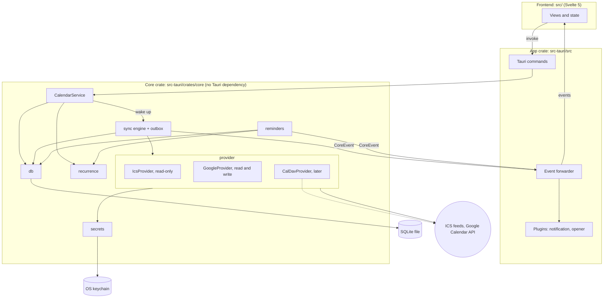
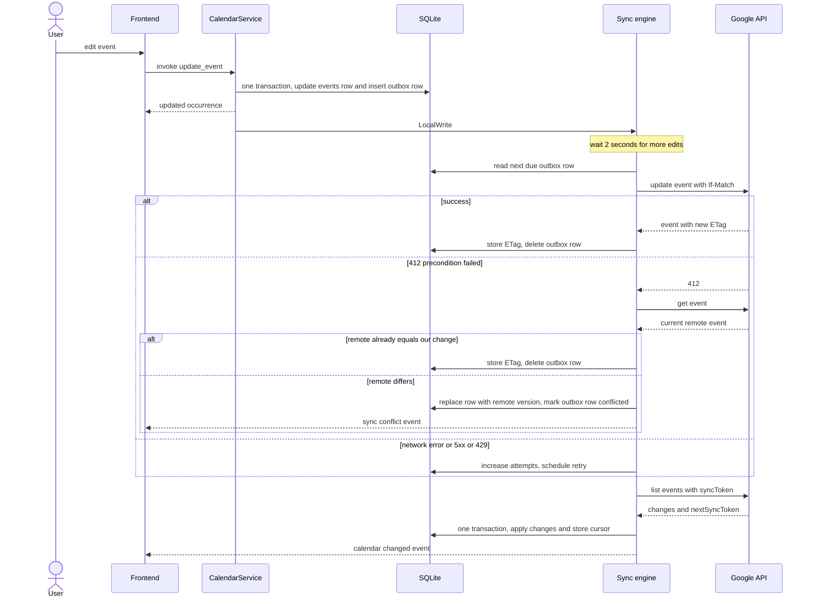

# Architecture

Status: proposed design, nothing in this document is implemented yet.
Last updated: 2026-10-13.

This document describes how SimpleCalendar stores, syncs and edits calendar data. It is the
reference for the implementation plan. The stack choice itself is recorded in
[ADR 0001](adr/0001-tauri-svelte.md).

## 1. Goals and non-goals

### In scope for v1

- ICS subscriptions (read-only) and Google Calendar (read and write), with any number of
  accounts or subscriptions per provider.
- A local calendar that needs no account, so the app is useful from the first launch.
- Create, edit and delete events. For recurring events: "only this event" and "all events".
- Offline edits through an outbox, incremental sync, server-wins conflict handling.
- Reminders with desktop notifications while the app is running.
- Credentials only in the OS keychain.

### Out of scope for v1

| Not in v1                            | Why, and what the design keeps open                                                                              |
| ------------------------------------ | ---------------------------------------------------------------------------------------------------------------- |
| CalDAV                               | Comes after v1. The provider trait and the cursor model are designed for it (§5).                                |
| "This and following events"          | Needs series splitting, the most error-prone calendar operation.                                                 |
| Attendees, invitations, RSVP         | Adds a table and partial-update rules. Guest data from Google is not stored.                                     |
| Tray icon, background sync           | Sync and reminders only run while the app is open. The scheduler has no window dependency, so this can be added. |
| Asking the user to resolve conflicts | Server wins in v1. The outbox keeps the rejected change, so a UI can come later.                                 |
| Mobile                               | The core crate has no Tauri or desktop dependency, which is the preparation for it.                              |

## 2. Overview

Three rules from `CLAUDE.md` shape everything below:

1. All calendar logic (parsing, recurrence, sync) lives in Rust.
2. The UI only ever reads the local SQLite database. It never waits for the network.
3. Writes to a remote calendar go through an outbox queue.



How to read it:

- The frontend calls Tauri commands. Commands are thin wrappers that call `CalendarService`
  and convert errors. They contain no logic.
- `CalendarService` is the only entry point into the core. Reads go straight to SQLite (plus
  recurrence expansion). Writes update SQLite, add an outbox row, and wake the sync engine.
- The sync engine is the only component that talks to providers, and the only one that applies
  remote changes to the database.
- Providers do HTTP and translation. They never touch the database.
- The core reports what happened through a channel of `CoreEvent` values. The app crate
  forwards them to the webview and, for due reminders, to the notification plugin.

## 3. Crate layout

`src-tauri/` becomes a small Cargo workspace. `cargo` commands keep running from `src-tauri/`
and `Cargo.lock` stays where it is.

```text
src-tauri/
├── Cargo.toml              # [workspace] plus the app crate
├── Cargo.lock
├── src/
│   ├── lib.rs              # builder, managed state, plugins, event forwarder
│   └── commands/           # #[tauri::command] wrappers
└── crates/core/
    └── src/
        ├── lib.rs          # CalendarService, CoreEvent
        ├── model/          # Source, Calendar, Event, Occurrence
        ├── db/             # connection, migrations, queries
        ├── provider/       # traits, ics, google
        ├── sync/           # engine, outbox, backoff
        ├── recurrence/     # RRULE expansion
        ├── reminders/      # scheduler
        └── secrets/        # keychain
```

The rule: `core` never depends on `tauri`. The compiler enforces it, because `tauri` is simply
not in that crate's `Cargo.toml`. Two practical benefits: the recurrence and sync tests compile
without the Tauri and WebKit stack, and the same crate can sit behind a mobile shell later.

## 4. Data model

Three persisted entities and one computed value.

| Type         | Meaning                                                                                   |
| ------------ | ----------------------------------------------------------------------------------------- |
| `Source`     | One account or subscription: a Google account, one ICS URL, or the built-in local source. |
| `Calendar`   | One calendar inside a source. A Google account has several, an ICS URL exactly one.       |
| `Event`      | A single event, the master of a recurring series, or an exception to a series.            |
| `Occurrence` | One concrete appearance of an event on the timeline. Computed per query, never stored.    |

### Source

- The id is a UUID, not an integer, because it is the key of the keychain entry (§8). Integer
  ids start again at 1 when the database is recreated, and a new source would then silently
  pick up a stale token left in the keychain by a previous installation.
- `kind` is `local`, `ics`, `google` or `caldav`.
- `status` is `ok`, `auth_required` or `error`. `auth_required` means the refresh token was
  rejected and the user has to sign in again. The engine stops syncing that source until then.
- A source row holds no secrets. For ICS it stores the host name for display, not the URL.

### Calendar

- `access` is `read` or `write` and comes from the provider (for Google: the access role of the
  account on that calendar).
- **A calendar is writable only if both are true:** its provider implements writing, and
  `access` is `write`. A Google calendar that someone shared with you read-only stays read-only.
- `sync_cursor` is an opaque string owned by the provider (§5).
- `color_override` and `visible` are local preferences and are never synced.

### Event

- **Times.** `start_utc` and `end_utc` are seconds since the Unix epoch, with `end_utc`
  exclusive. `start_tz` is the IANA zone the event was created in (for example
  `Europe/Brussels`). The zone is needed for recurrence: a weekly meeting at 09:00 in Brussels
  must stay at 09:00 local time when daylight saving changes, which moves its UTC time.
- **All-day events** have no zone: "25 December" is the same date everywhere. They are stored
  with `all_day = 1` and both timestamps at midnight UTC of their dates. Rust converts them to
  plain dates when reading.
- **Recurring series.** The master row carries the recurrence lines (`RRULE`, `RDATE`,
  `EXDATE`) exactly as iCalendar and Google express them. Its `start_utc` and `end_utc`
  describe the first occurrence.
- **Exceptions.** An edited occurrence is its own row that points at the master through
  `recurring_event_id` and names the occurrence it replaces through `original_start_utc`. A
  deleted occurrence is the same kind of row with `status = 'cancelled'`. Google sends
  exceptions in exactly this shape, so nothing has to be translated.
- **Identity.** `remote_id` is the provider's id. For events created in this app it is
  generated here, before the event is sent (§7.3).

### Occurrence

`list_occurrences(from, to)` returns occurrences, not events. An occurrence is identified by
`(event_id, original_start)`. For a single event `original_start` equals its start. For a
recurring one it is the start the rule produced, even if an exception moved it.

Occurrences are computed for the requested range only and are never written to the database.
A series without an end date has infinitely many, so storing them is not an option, and
computing a month of them is cheap.

## 5. Provider trait

### Shape

Reading and writing are two traits. A read-only provider implements only the first, so there is
no write method on it that could be called by mistake.

The code below is a design sketch. It has not been compiled.

```rust
/// What the UI may offer for calendars of this provider. Plain data, serialisable.
pub struct Capabilities {
    /// Events can be created, edited and deleted.
    pub writable: bool,
    /// `pull` can return only what changed since a cursor.
    pub incremental_sync: bool,
    /// Reminders round-trip to the server.
    pub reminders: bool,
}

#[async_trait]
pub trait CalendarProvider: Send + Sync {
    fn kind(&self) -> SourceKind;
    fn capabilities(&self) -> Capabilities;

    /// The calendars this source currently exposes.
    async fn list_calendars(&self, cx: &SourceContext)
        -> Result<Vec<RemoteCalendar>, ProviderError>;

    /// One page of changes. `cursor = None` asks for everything.
    async fn pull(
        &self,
        cx: &SourceContext,
        calendar: &CalendarRef,
        cursor: Option<&SyncCursor>,
        page: Option<&PageToken>,
    ) -> Result<ChangeSet, ProviderError>;

    /// `Some` if this provider can write. The default is read-only.
    fn as_writable(&self) -> Option<&dyn WritableProvider> {
        None
    }
}

#[async_trait]
pub trait WritableProvider: CalendarProvider {
    async fn get_event(&self, cx: &SourceContext, calendar: &CalendarRef, id: &RemoteId)
        -> Result<Option<RemoteEvent>, ProviderError>;

    async fn create_event(&self, cx: &SourceContext, calendar: &CalendarRef, draft: &EventDraft)
        -> Result<RemoteEvent, ProviderError>;

    /// `if_match` is the ETag the edit was based on. A mismatch is `ProviderError::Conflict`.
    async fn update_event(
        &self,
        cx: &SourceContext,
        calendar: &CalendarRef,
        draft: &EventDraft,
        if_match: Option<&Etag>,
    ) -> Result<RemoteEvent, ProviderError>;

    async fn delete_event(
        &self,
        cx: &SourceContext,
        calendar: &CalendarRef,
        id: &RemoteId,
        if_match: Option<&Etag>,
    ) -> Result<(), ProviderError>;
}

pub struct ChangeSet {
    pub upserts: Vec<RemoteEvent>,
    pub deletions: Vec<RemoteId>,
    /// true: this pull describes the whole calendar; anything not seen must be deleted locally.
    pub full: bool,
    pub next: Next,
}

pub enum Next {
    /// More pages follow. Nothing is saved as a cursor yet.
    Page(PageToken),
    /// Last page. Store this cursor together with the applied changes.
    Done(SyncCursor),
}

pub enum ProviderError {
    /// Network trouble, HTTP 5xx, rate limit. Retry later.
    Transient { retry_after: Option<Duration> },
    /// Credentials rejected. The user has to sign in again.
    Auth,
    /// The remote copy changed since `if_match`.
    Conflict,
    /// The cursor is no longer valid. Start over with a full pull.
    CursorInvalid,
    NotFound,
    /// Will never succeed (bad request, forbidden). Do not retry.
    Permanent(String),
}
```

Rust notes, since these parts are not obvious:

- A **trait** is Rust's interface. `dyn CalendarProvider` is a "trait object": a value whose
  concrete type is only known at run time. The engine needs that, because it keeps ICS and
  Google providers in one map and calls them the same way.
- **`Send + Sync`** says a provider may be moved to and shared between threads. The async
  runtime (tokio) runs tasks on a pool of threads, so anything a task holds across an `.await`
  must be thread-safe.
- **`#[async_trait]`**: an `async fn` returns a hidden future type that is different for every
  implementation. A trait object needs one fixed signature, so it cannot expose those directly.
  The `async-trait` macro rewrites each method to return a boxed future
  (`Pin<Box<dyn Future + Send>>`). The cost is one small heap allocation per call, which is
  nothing next to an HTTP request.
- **`WritableProvider: CalendarProvider`** is a supertrait: everything writable is also
  readable. `as_writable` returns `Option<&dyn WritableProvider>`, so the caller has to handle
  the read-only case; the compiler will not let it be forgotten.

`capabilities().writable` must equal `as_writable().is_some()`. A test checks this for every
provider. `Capabilities` exists because the UI needs plain data to decide whether to show an
edit button.

### Rules for providers

- **No database access.** A provider receives what it needs (`SourceContext` carries the HTTP
  client and a way to get a valid access token) and returns plain values. The engine does all
  database work. This keeps providers testable against a mock HTTP server, and the engine
  testable with a fake provider.
- **The cursor is opaque.** The engine stores `SyncCursor` and hands it back, nothing else.
- **Errors are classified by the provider.** The engine only reacts to the six variants above.

### Providers

| Provider | Writable | Cursor contents                                                                                      |
| -------- | -------- | ---------------------------------------------------------------------------------------------------- |
| ICS      | no       | JSON with the HTTP `ETag`, `Last-Modified` and a hash of the body                                    |
| Google   | yes      | `nextSyncToken`                                                                                      |
| CalDAV   | yes      | Later: a WebDAV sync-token, or the collection ctag plus the per-event ETags already in `events.etag` |

**Local calendars are not a provider.** A source of kind `local` has no provider at all. The
sync engine skips it, and writes to its calendars do not create outbox rows.

### What CalDAV needs from this design

Nothing in v1, but the trait was shaped so it fits later without changes:

- `pull` with an opaque cursor covers both CalDAV strategies (sync-token reports, or comparing
  ETags).
- `if_match` on update and delete is how CalDAV does optimistic locking too.
- `events.etag` and `events.ical_uid` exist from the first migration.
- `full = true` covers servers without incremental sync.

## 6. SQLite schema

One database file in the app-data directory. The schema is created by numbered migrations; the
current migration number is stored in SQLite's built-in `PRAGMA user_version`.

Set on every connection:

```sql
PRAGMA journal_mode = WAL;
PRAGMA foreign_keys = ON;
PRAGMA busy_timeout = 5000;
```

`WAL` lets a read proceed while a write is in progress. `foreign_keys` is off by default in
SQLite and has to be switched on, otherwise `ON DELETE CASCADE` does nothing.

Migration 1:

```sql
CREATE TABLE sources (
    id              TEXT PRIMARY KEY,           -- UUID; also the keychain key
    kind            TEXT NOT NULL CHECK (kind IN ('local', 'ics', 'google', 'caldav')),
    display_name    TEXT NOT NULL,
    account_label   TEXT,                       -- Google account or ICS host; never a secret
    status          TEXT NOT NULL DEFAULT 'ok'
                    CHECK (status IN ('ok', 'auth_required', 'error')),
    last_error      TEXT,
    sync_interval_s INTEGER,                    -- NULL = provider default
    created_at      INTEGER NOT NULL
) STRICT;

CREATE TABLE calendars (
    id                INTEGER PRIMARY KEY,
    source_id         TEXT NOT NULL REFERENCES sources (id) ON DELETE CASCADE,
    remote_id         TEXT NOT NULL,            -- provider's calendar id; a UUID for local ones
    name              TEXT NOT NULL,
    color             TEXT,                     -- '#rrggbb' from the provider
    color_override    TEXT,                     -- user's choice, never synced
    time_zone         TEXT,                     -- IANA name; default zone for new events
    access            TEXT NOT NULL CHECK (access IN ('read', 'write')),
    visible           INTEGER NOT NULL DEFAULT 1 CHECK (visible IN (0, 1)),
    is_primary        INTEGER NOT NULL DEFAULT 0 CHECK (is_primary IN (0, 1)),
    default_reminders TEXT NOT NULL DEFAULT '[]', -- JSON array of minutes before start
    sync_cursor       TEXT,                     -- opaque, owned by the provider
    last_synced_at    INTEGER,
    UNIQUE (source_id, remote_id)
) STRICT;

CREATE TABLE events (
    id                    INTEGER PRIMARY KEY,
    calendar_id           INTEGER NOT NULL REFERENCES calendars (id) ON DELETE CASCADE,
    remote_id             TEXT NOT NULL,        -- provider's id; generated here for new events
    ical_uid              TEXT,
    etag                  TEXT,                 -- NULL until the server has confirmed the row
    status                TEXT NOT NULL DEFAULT 'confirmed'
                          CHECK (status IN ('confirmed', 'tentative', 'cancelled')),
    title                 TEXT NOT NULL DEFAULT '',
    description           TEXT,
    location              TEXT,
    color                 TEXT,
    all_day               INTEGER NOT NULL DEFAULT 0 CHECK (all_day IN (0, 1)),
    start_utc             INTEGER NOT NULL,     -- epoch seconds
    end_utc               INTEGER NOT NULL,     -- epoch seconds, exclusive
    start_tz              TEXT,                 -- IANA name; NULL for all-day events
    end_tz                TEXT,
    recurrence            TEXT,                 -- RRULE/RDATE/EXDATE lines; NULL if not a master
    recurrence_end_utc    INTEGER,              -- end of the last occurrence; NULL = no end
    recurring_event_id    INTEGER REFERENCES events (id) ON DELETE CASCADE,
    original_start_utc    INTEGER,              -- the occurrence an exception replaces
    use_default_reminders INTEGER NOT NULL DEFAULT 1 CHECK (use_default_reminders IN (0, 1)),
    pending_delete        INTEGER NOT NULL DEFAULT 0 CHECK (pending_delete IN (0, 1)),
    remote_updated_at     INTEGER,
    UNIQUE (calendar_id, remote_id),
    CHECK (end_utc >= start_utc),
    CHECK ((recurring_event_id IS NULL) = (original_start_utc IS NULL)),
    CHECK (recurrence IS NULL OR recurring_event_id IS NULL)
) STRICT;

CREATE INDEX events_single ON events (calendar_id, start_utc, end_utc)
    WHERE recurrence IS NULL;
CREATE INDEX events_masters ON events (calendar_id)
    WHERE recurrence IS NOT NULL;
CREATE INDEX events_exceptions ON events (recurring_event_id)
    WHERE recurring_event_id IS NOT NULL;

CREATE TABLE event_reminders (
    event_id       INTEGER NOT NULL REFERENCES events (id) ON DELETE CASCADE,
    method         TEXT NOT NULL DEFAULT 'popup' CHECK (method IN ('popup', 'email')),
    minutes_before INTEGER NOT NULL CHECK (minutes_before BETWEEN 0 AND 40320),
    PRIMARY KEY (event_id, method, minutes_before)
) STRICT, WITHOUT ROWID;

CREATE TABLE fired_reminders (
    event_id         INTEGER NOT NULL REFERENCES events (id) ON DELETE CASCADE,
    occurrence_start INTEGER NOT NULL,
    minutes_before   INTEGER NOT NULL,
    fired_at         INTEGER NOT NULL,
    PRIMARY KEY (event_id, occurrence_start, minutes_before)
) STRICT, WITHOUT ROWID;

CREATE TABLE outbox (
    id              INTEGER PRIMARY KEY AUTOINCREMENT, -- processing order
    calendar_id     INTEGER NOT NULL REFERENCES calendars (id) ON DELETE CASCADE,
    event_id        INTEGER REFERENCES events (id) ON DELETE SET NULL,
    event_remote_id TEXT NOT NULL,
    op              TEXT NOT NULL CHECK (op IN ('create', 'update', 'delete')),
    payload         TEXT,                       -- JSON: the state the user wants; NULL for delete
    base            TEXT,                       -- JSON: the row as the server last confirmed it
    base_etag       TEXT,                       -- sent as If-Match
    status          TEXT NOT NULL DEFAULT 'pending'
                    CHECK (status IN ('pending', 'in_flight', 'conflicted', 'failed')),
    attempts        INTEGER NOT NULL DEFAULT 0,
    next_attempt_at INTEGER NOT NULL DEFAULT 0,
    last_error      TEXT,
    created_at      INTEGER NOT NULL
) STRICT;

CREATE INDEX outbox_due ON outbox (status, next_attempt_at);
CREATE INDEX outbox_event ON outbox (event_id);

CREATE TABLE settings (
    key   TEXT PRIMARY KEY,
    value TEXT NOT NULL
) STRICT, WITHOUT ROWID;
```

Notes:

- `STRICT` makes SQLite reject a value of the wrong type instead of storing it anyway.
- `event_reminders.method` keeps Google's `email` reminders intact when an event is saved back.
  Only `popup` reminders produce a notification.
- `settings` holds non-secret preferences (week start, sync intervals, an optional OAuth client
  id override). Secrets never go here.
- There is no table for occurrences, by design (§4).

### Reading a date range

Two queries, then expansion in Rust. Both ranges are widened by 14 hours on each side before
querying, because an all-day event stored at midnight UTC can fall on the neighbouring day in
the viewer's zone. Rust filters the result precisely.

```sql
-- Single events and exceptions that overlap the range.
SELECT e.*
FROM events e
JOIN calendars c ON c.id = e.calendar_id
WHERE c.visible = 1
  AND e.recurrence IS NULL
  AND e.pending_delete = 0
  AND e.start_utc < :to
  AND e.end_utc > :from;

-- Series that can still produce an occurrence in the range.
SELECT e.*
FROM events e
JOIN calendars c ON c.id = e.calendar_id
WHERE c.visible = 1
  AND e.recurrence IS NOT NULL
  AND e.pending_delete = 0
  AND e.start_utc < :to
  AND (e.recurrence_end_utc IS NULL OR e.recurrence_end_utc > :from);
```

For each series the `recurrence` module expands the rule inside the range, in the event's own
zone. All exceptions of that series are loaded through `events_exceptions`; each one removes the
occurrence it replaces. Exceptions that are not cancelled already appear in the first query, at
their own (possibly moved) time.

### Access from Rust

One `rusqlite::Connection` behind a mutex, shared through an `Arc`. SQLite calls are blocking,
so they run through `tokio::task::spawn_blocking`, which moves them to a thread where blocking
is allowed and keeps the async threads free. One connection is enough: queries take
microseconds to low milliseconds, and a pool would only cost memory.

## 7. Sync engine

### 7.1 Structure

One long-lived task owns a queue of commands (`SyncNow(source)`, `LocalWrite(source)`,
`Shutdown`). At most one sync cycle runs per source at a time. A request that arrives during a
cycle sets a "run again" flag instead of starting a second one. Different sources sync in
parallel.

Triggers:

| Trigger            | Behaviour                                                  |
| ------------------ | ---------------------------------------------------------- |
| App start          | Every source once                                          |
| Timer              | Google every 15 minutes, ICS every 60, per-source override |
| Window gains focus | Every source, at most once per minute                      |
| Local write        | That source, 2 seconds after the last write                |
| Manual refresh     | Immediately                                                |

### 7.2 One cycle for one source

1. **Authenticate.** Get an access token, refreshing it if needed.
2. **Push.** Send due outbox rows in order (§7.3).
3. **List calendars.** Add new ones, update names, colours and access, remove those that are
   gone.
4. **Pull.** For each calendar, page through `pull`. Each page is applied in its own
   transaction. On the last page, the changes **and the new cursor are committed in the same
   transaction**. A crash can therefore never leave a cursor that claims more than what was
   applied.
5. **Notify.** Emit `calendar:changed` with the affected calendar ids.

Push comes before pull so that the pull already sees the result of our own writes.

Applying a page:

- Series masters are applied before exceptions, since an exception references its master.
- For a full pull (`full = true`) the engine remembers every remote id it saw. After the last
  page it deletes local events that were not seen, except those that still have a pending
  `create` in the outbox.
- An upsert for an event that has a pending outbox row is a conflict (§7.4).

### 7.3 Outbox

A local edit to a remote calendar is one SQLite transaction that

1. changes the `events` row, so the UI shows the edit immediately, and
2. inserts an outbox row with the desired state (`payload`), the state before the edit (`base`)
   and the ETag the edit was based on (`base_etag`).

Either both happen or neither.

Rules:

- **Order.** Rows are processed by `id`. Rows for the same event never overtake each other.
- **Coalescing.** A second edit to an event that still has a pending row updates that row's
  payload and keeps the original `base`. An update to an event with a pending `create` merges
  into the create. A delete of an event with a pending `create` removes both: the server never
  hears about it.
- **Deletes.** The row stays in `events` with `pending_delete = 1` and is hidden from queries.
  It is removed once the server confirms.
- **Safe retries for creates.** The event id is generated here (a UUID in hexadecimal, which
  fits Google's rule of 5 to 1024 characters from `a`-`v` and `0`-`9`) and sent with the insert.
  If the response is lost and the insert is retried, Google reports that the id exists. That is
  treated as success, and the event is fetched to get its ETag. Without this, a lost response
  would create a duplicate.
- **Crash recovery.** At startup, rows left `in_flight` go back to `pending`.

Outcome per attempt:

| Result               | Action                                                                                                           |
| -------------------- | ---------------------------------------------------------------------------------------------------------------- |
| Success              | Store the new ETag on the event, delete the outbox row                                                           |
| `Transient`          | `attempts + 1`, set `next_attempt_at` with exponential backoff and jitter (cap 30 minutes), honour `Retry-After` |
| `Auth`               | Refresh the token once and retry. If that fails: source becomes `auth_required`, rows stay `pending`             |
| `Conflict`           | See §7.4                                                                                                         |
| `NotFound` on update | The event was deleted remotely. Treated as a conflict: remove locally, row becomes `conflicted`                  |
| `NotFound` on delete | Already gone. Success                                                                                            |
| `Permanent`          | Roll the event back to `base` (or remove it, for a create). Row becomes `failed`                                 |

`conflicted` and `failed` rows are kept so the UI can list them ("your change to X could not be
saved") and the user can dismiss or redo them. They no longer block later edits to the event.

### 7.4 Conflicts: server wins

A conflict is one of:

- the server answers an update or delete with HTTP 412, because the ETag no longer matches, or
- a pull delivers a change for an event that still has a pending outbox row.

Handling:

1. On 412 the engine fetches the event once. If the remote copy already equals what we wanted
   to write, our earlier attempt succeeded and only its response was lost: store the ETag,
   delete the row, no notice. This avoids false conflict reports after a dropped connection.
2. Otherwise the remote version replaces the local row, the outbox row becomes `conflicted`
   with its `payload` intact, and `sync:conflict` is emitted.

Nothing is ever overwritten on the server without an ETag check, so an edit made on a phone or
by someone else is never silently lost.



### 7.5 Google specifics

Checked against Google's Calendar API documentation on 2026-10-13.

- **First sync:** `events.list` without a token, following `nextPageToken` until the last page,
  which carries `nextSyncToken`. The provider returns `full = true`.
- **Incremental sync:** the same request with `syncToken`. The request parameters must be the
  same as in the first sync, and most filters cannot be combined with a sync token.
- **Recurring events** are requested unexpanded (`singleEvents=false`), so the response
  contains masters and exceptions, which is what the schema stores.
- **Deletions** arrive as events with `status = cancelled`. A cancelled entry that has a
  `recurringEventId` is a cancelled occurrence and is stored as an exception. A cancelled entry
  without one is a real deletion.
- **HTTP 410** means the sync token expired. The provider returns `CursorInvalid`, the engine
  clears the cursor and runs a full pull.
- **Writes** send `If-Match` with the stored ETag; a mismatch is HTTP 412.
- **"Only this event"** edits address the single occurrence on Google's side. How that
  occurrence is looked up is internal to `GoogleProvider`.
- **Reminders** map to `reminders.useDefault` and `reminders.overrides` (at most 5, each 0 to
  40320 minutes). Calendar defaults are stored in `calendars.default_reminders`.

### 7.6 ICS specifics

- `webcal://` URLs are rewritten to `https://`.
- The request sends `If-None-Match` and `If-Modified-Since` from the cursor. HTTP 304 means
  nothing changed.
- Otherwise the body is hashed. If the hash equals the one in the cursor, nothing changed
  either (many servers do not support conditional requests).
- If it did change, the feed is parsed and returned as one `full = true` change set.
- `remote_id` is the event's `UID`, combined with `RECURRENCE-ID` for exceptions.
- Alarms inside a feed (`VALARM`) are ignored in v1.

## 8. Credentials

### What is stored where

| Item                               | Location                                      |
| ---------------------------------- | --------------------------------------------- |
| Google refresh token               | OS keychain                                   |
| Google access token                | Memory only. Short-lived, re-created at start |
| Full ICS URL                       | OS keychain                                   |
| OAuth client secret override       | OS keychain                                   |
| Account label, ICS host, client id | SQLite (not secret)                           |

ICS URLs are treated as secrets because private feed addresses, including Google's own "secret
address in iCal format", contain a token that grants access to the calendar.

Keychain entries use the bundle identifier as the service name
(`com.adriaancloet.simplecalendar`) and `source:<uuid>` as the account. The value is a small
JSON document with a version field. Only the refresh token is stored, not the whole token
response: Windows limits a credential to 2560 bytes.

### Platforms

| Platform | Backend                                                           |
| -------- | ----------------------------------------------------------------- |
| Ubuntu   | Secret Service over D-Bus, provided by GNOME Keyring (or KWallet) |
| Windows  | Credential Manager                                                |

### `SecretStore`

The core defines a small trait with `probe`, `get`, `set` and `delete`. There are two
implementations: one on top of the keychain, and an in-memory one for tests. Keychain calls can
block (on Linux they may show an unlock prompt), so they also run through `spawn_blocking`.

### When no keyring is available

This happens on Linux with a minimal window manager, in a session without GNOME Keyring, or
when the keyring is locked and the prompt is dismissed.

- At startup the store is probed with a harmless read.
- If the probe fails, the app **keeps working for local calendars**. Remote sources are not
  synced, and adding one is blocked.
- There is **no fallback to a file or to SQLite**, in any circumstance.
- The error distinguishes two cases and tells the user what to do:

| Case       | Message                                                                                                                                                                                                                                                      |
| ---------- | ------------------------------------------------------------------------------------------------------------------------------------------------------------------------------------------------------------------------------------------------------------ |
| No service | "SimpleCalendar could not find a system keyring. Account credentials are stored in the system keyring (GNOME Keyring or KWallet), never in files. Install and start `gnome-keyring`, log in again and restart SimpleCalendar. Local calendars keep working." |
| Locked     | "The system keyring is locked. Unlock it and try again."                                                                                                                                                                                                     |

The frontend gets this as a structured error (`secrets_unavailable` with a reason), not as a
string to parse, and can re-run the probe from a "Try again" button.

`keyring-core` reports a locked or denied store as `NoStorageAccess`. Which error the D-Bus
store returns when no Secret Service is running at all is not documented, so the implementation
plan includes a test in a session without a keyring to pin that mapping down.

### Google sign-in

- OAuth 2.0 authorization code flow with PKCE, for an "installed application".
- The app listens on `127.0.0.1` on a free port, opens the system browser at Google's consent
  page with that address as redirect URI, receives the code, and exchanges it for tokens. The
  `state` parameter is checked. The listener closes after one request or after 5 minutes.
- **Client id and secret** are read at compile time from environment variables
  (`option_env!`, which yields `None` if the variable is not set) and are never committed. The
  local build takes them from an untracked `.env`, CI from a repository secret. If none were
  compiled in, Google sign-in asks for a client id in settings.
- A runtime override in settings takes precedence, so anyone building from source can use their
  own Google Cloud project.
- Google treats the client secret of an installed application as not confidential, since it can
  be extracted from any binary. Keeping it out of git is still correct: it avoids the repository
  being flagged and makes rotating it a CI change.
- To verify during implementation: Google's OAuth documentation says that projects whose consent
  screen is in "Testing" status get refresh tokens that expire after 7 days. That would show up
  here as `auth_required` once a week.

## 9. Reminders

- A scheduler task in the core looks at the occurrences of the next 24 hours, computes the
  earliest due reminder, and sleeps until then. It recomputes whenever the database changes.
- When a reminder is due it writes a `fired_reminders` row and emits `CoreEvent::ReminderDue`.
  The app crate turns that into a desktop notification.
- `fired_reminders` prevents a second notification after a restart. Rows older than a week are
  pruned at startup.
- A reminder that became due while the app was closed is still shown at the next start if the
  event has not started yet. Otherwise it is skipped.
- The scheduler does not know whether a window exists. Running it from a tray process later
  needs no change in the core.

## 10. Frontend contract

Commands (all async, all return `Result`):

| Command                                  | Purpose                                                       |
| ---------------------------------------- | ------------------------------------------------------------- |
| `get_status`                             | Keyring availability, sources needing sign-in, open conflicts |
| `list_sources`, `remove_source`          | Manage accounts and subscriptions                             |
| `add_ics_source(url, name)`              | Subscribe to a feed                                           |
| `begin_google_sign_in`                   | Start the OAuth flow; resolves when the browser step finishes |
| `list_calendars`, `update_calendar`      | Visibility and colour override                                |
| `create_local_calendar`                  | New calendar in the local source                              |
| `list_occurrences(from, to, tz)`         | Everything the views render                                   |
| `get_event(event_id)`                    | Full detail for the editor                                    |
| `create_event(draft)`                    | Returns the new occurrence                                    |
| `update_event(target, scope, draft)`     | `scope` is `this` or `all`                                    |
| `delete_event(target, scope)`            |                                                               |
| `sync_now(source?)`                      | Manual refresh                                                |
| `list_sync_issues`, `dismiss_sync_issue` | `conflicted` and `failed` outbox rows                         |

Events from Rust to the webview:

| Event              | Payload                      |
| ------------------ | ---------------------------- |
| `calendar:changed` | Affected calendar ids        |
| `sync:status`      | Source id, state, last error |
| `sync:conflict`    | Outbox row id, event title   |

Conventions:

- The frontend passes its IANA zone (`Intl.DateTimeFormat().resolvedOptions().timeZone`) to
  `list_occurrences`. Rust returns wall-clock times in that zone. The frontend lays out and
  formats, and does no date arithmetic that depends on zones or recurrence.
- Timed values cross the boundary as ISO 8601 strings with offset, all-day values as
  `YYYY-MM-DD`.
- After `calendar:changed` the frontend re-runs `list_occurrences` for the visible range.
- Notifications and opening the browser are done from Rust. The frontend needs no extra plugin
  permission for them.

## 11. Proposed crates

`CLAUDE.md` asks for a justification per dependency. Versions were checked on crates.io on
2026-10-13. "Already built" means the crate is compiled for the Linux target today because Tauri
depends on it; this was verified with `cargo tree`. The Windows tree could not be inspected
offline.

### Core crate

| Crate                                   | Purpose                              | Why this one                                                                                                                                                 | Rejected                                                                                        |
| --------------------------------------- | ------------------------------------ | ------------------------------------------------------------------------------------------------------------------------------------------------------------ | ----------------------------------------------------------------------------------------------- |
| `rusqlite` 0.40, feature `bundled`      | SQLite                               | Small synchronous binding. `bundled` compiles SQLite into the binary: same version on both platforms, nothing to install on Windows                          | `sqlx` (connection pool, macros, build-time database), `tauri-plugin-sql` (SQL in the frontend) |
| `rusqlite_migration` 2.6                | Schema migrations                    | Tiny, uses `user_version`, depends only on `rusqlite` and `log`. Could be replaced by about 25 lines of our own                                              | `refinery` (more than needed)                                                                   |
| `tokio` 1                               | Async runtime, channels, timers      | Already built: Tauri runs on it                                                                                                                              | A second runtime                                                                                |
| `reqwest` 0.13                          | HTTP client                          | Async, on tokio, the de facto standard. New compile cost: it is in `Cargo.lock` but not built on Linux today                                                 | `ureq` (blocking), `google-calendar3` (large generated client)                                  |
| `chrono` 0.4, `chrono-tz` 0.10          | Dates, times, IANA zones             | `rrule` and `icalendar` are built on them. `chrono-tz` embeds the zone database, which Windows does not provide. This adds to the binary size                | `jiff` (nicer API, but every recurrence call would need conversions)                            |
| `rrule` 0.14                            | Recurrence expansion (RFC 5545)      | The established implementation. **Risk:** last release April 2025. Mitigation: it is used in one module behind one function, and our tests are written first | Writing an expander ourselves                                                                   |
| `icalendar` 0.17, feature `parser`      | ICS parsing                          | Maintained (release September 2026), on chrono                                                                                                               | `ical` (no release since March 2024), `calcard` (pulls in mail parsers)                         |
| `keyring-core` 1.0                      | Keychain API                         | `keyring` 4 was split into this crate plus one store crate per platform                                                                                      | Stronghold (not the OS keychain), any file-based store                                          |
| `dbus-secret-service-keyring-store` 1.0 | Linux keychain backend               | Uses libdbus, which is already built through Tauri's windowing layer                                                                                         | `zbus-secret-service-keyring-store` (brings a second D-Bus implementation)                      |
| `windows-native-keyring-store` 1.1      | Windows keychain backend             | Credential Manager through `windows-sys`                                                                                                                     |                                                                                                 |
| `oauth2` 5.0                            | OAuth 2.0 with PKCE                  | PKCE, the state check and token refresh are easy to get subtly wrong. **Risk:** last release January 2025. Fallback: about 150 lines on `reqwest` and `sha2` | Hand-rolled as the first choice                                                                 |
| `async-trait`                           | Async methods on trait objects       | See §5                                                                                                                                                       | Enum dispatch (more boilerplate per provider)                                                   |
| `thiserror` 2                           | Error enums                          | Already built                                                                                                                                                |                                                                                                 |
| `uuid` 1                                | Source ids, event ids                | Already built                                                                                                                                                |                                                                                                 |
| `serde`, `serde_json`, `log`            | Serialisation, logging               | Already direct dependencies                                                                                                                                  |                                                                                                 |
| `wiremock` 0.6 (dev only)               | Fake Google and ICS servers in tests | Never part of the shipped binary                                                                                                                             |                                                                                                 |

The two keychain store crates are platform-specific dependencies, so each platform compiles
only its own.

### App crate

| Crate                         | Purpose                             | Why                   |
| ----------------------------- | ----------------------------------- | --------------------- |
| `tauri-plugin-opener` 2       | Open the browser for Google sign-in | Official Tauri plugin |
| `tauri-plugin-notification` 2 | Reminder notifications              | Official Tauri plugin |

### Deliberately not added

- `tauri-plugin-oauth`: the loopback listener is about 40 lines on `tokio::net::TcpListener`.
- `tauri-plugin-store`, `tauri-plugin-stronghold`: not allowed to hold tokens, not needed for
  anything else.
- A type-generation crate for the frontend types: reconsider once the command list is stable.

## 12. Testing strategy

- **Recurrence and time zones: tests first**, as `CLAUDE.md` requires. Cases to cover before
  writing the implementation: daylight-saving changes in both directions, a local time that
  does not exist or exists twice, all-day series, `UNTIL` and `COUNT`, `EXDATE`, moved and
  cancelled exceptions, an occurrence moved into or out of the queried range, and a viewer in a
  different zone than the event.
- **Database:** every test opens an in-memory SQLite database and runs all migrations.
- **Providers:** against `wiremock`, with recorded response shapes. Includes pagination, HTTP
  410, 412, 429 and a lost response on create.
- **Sync engine:** with a scripted fake provider. Includes coalescing, crash recovery of
  `in_flight` rows, both conflict paths and the "our write already succeeded" path.
- **Secrets:** the in-memory store everywhere; the real keychain only in an opt-in test.
- The frontend has no test runner, which is one more reason to keep logic out of it.

## 13. Open points

To be settled in the implementation plan, not guessed here:

1. **TLS backend for `reqwest`.** Platform TLS or rustls. The Linux keychain store also needs a
   crypto feature (`crypto-rust` or `crypto-openssl`), so both choices should be made together
   to avoid shipping two crypto stacks.
2. **`async-trait`.** Check whether the current toolchain (rustc 1.99) allows native `async fn`
   through `dyn`. If so, drop the crate.
3. **Calendar list sync.** Google's sync guide does not say whether `calendarList` supports
   sync tokens. v1 lists calendars in full every cycle, which is a small request.
4. **Colliding event ids.** Google does not guarantee that a duplicate client-supplied id is
   detected at insert time. With random UUIDs the chance is negligible; accepted.
5. **Size of the first Google sync.** It fetches the complete history. A time window is a
   possible later optimisation, with the restriction that the parameters must stay identical
   across the sync chain.
6. **OAuth scopes.** Use the narrowest scopes that allow listing calendars and editing events.
   Exact names to be confirmed.
7. **Refresh-token lifetime** for a consent screen in "Testing" status (§8).
8. **Reminders on read-only calendars.** Local reminders for ICS events are not in v1.
